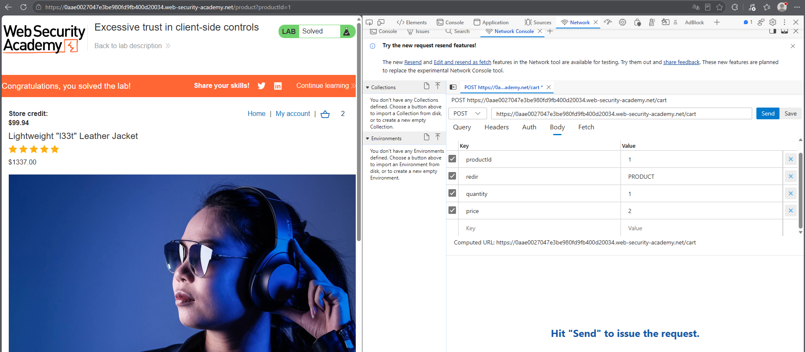
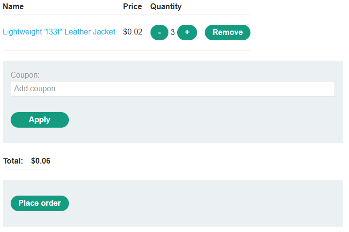

# PortSwigger Lab: Excessive trust in client-side controls

## Описание лаборатории
- **Платформа:** PortSwigger Web Security Academy
- **Сложность:** Apprentice
- **Цель:** Проэксплуатировать логическую ошибку в сценарии оформления покупки, чтобы купить "Lightweight l33t leather jacket" (Легкую кожаную куртку l33t) по непредусмотренной цене.

## Анализ уязвимости
Сценарий оформления покупки в приложении полагается на клиентские средства контроля для определения цены товаров. Когда пользователь добавляет товар в корзину, клиент отправляет POST-запрос на `/cart`, содержащий `productId` и `price`.

Поскольку сервер не проверяет цену по базе данных, злоумышленник может перехватить запрос и изменить параметр `price` на произвольное значение перед отправкой.

## Шаги эксплуатации
1. Выполнен вход в приложение с использованием предоставленных учетных данных (`wiener:peter`).
2. Выполнен переход на страницу товара "Lightweight l33t leather jacket" (исходная цена: $1337.00).
3. Нажата кнопка "Add to cart" (Добавить в корзину), и перехвачен запрос `POST /cart` с помощью инструментов разработчика браузера.
4. Параметр `price` в теле запроса изменен с `133700` на `2` (или `1`).
5. Отправлен измененный запрос. Сервер принял новую цену и добавил товар в корзину за $0.02.
6. Выполнен переход к оформлению заказа, и заказ был размещен, что позволило успешно купить куртку по измененной цене.

## Доказательства

### Измененный запрос (Подмена цены)

### Корзина с измененной ценой

### Лаборатория решена

## Меры защиты (Mitigation)
Для предотвращения этой уязвимости сервер никогда не должен доверять данным о ценах, предоставленным клиентом.
1. **Серверная валидация цены:** Сервер должен извлекать цену товара непосредственно из базы данных, используя `productId`, и игнорировать любые значения цены, предоставленные клиентом.
2. **Целостность сессии:** Рассчитывать общую стоимость заказа на стороне сервера и проверять ее при оформлении.