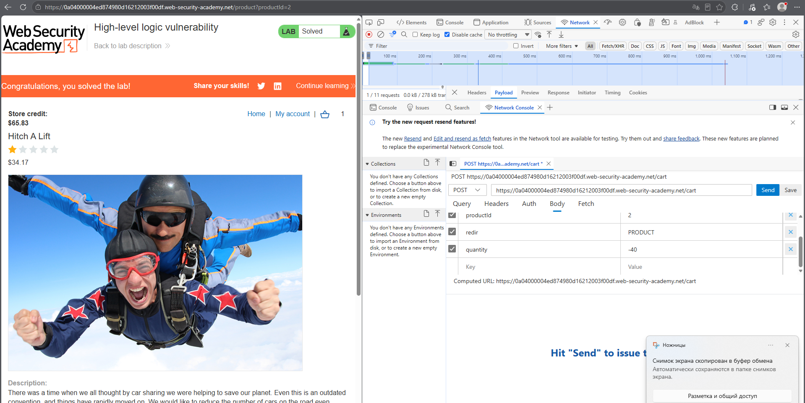
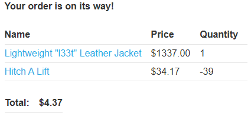
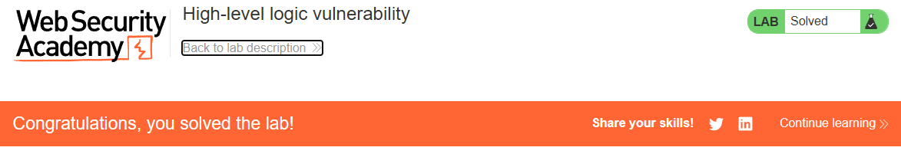

# PortSwigger Lab: High-level logic vulnerability

## Lab Description
- **Platform:** PortSwigger Web Security Academy
- **Difficulty:** Apprentice
- **Objective:** Exploit a logic flaw in the purchasing workflow to buy a "Lightweight l33t leather jacket" for an unintended price.

## Vulnerability Analysis
The application fails to adequately validate the quantity of items added to the cart. While it checks that the final cart total is not less than zero, it does not prevent individual items from having a negative quantity.

By adding a cheap item with a large negative quantity, an attacker can reduce the total price of the cart. This allows them to offset the high cost of the leather jacket and purchase it for a fraction of its real price, as long as the final total remains positive.

## Exploitation Steps
1. Logged in to the application using the provided credentials (`wiener:peter`).
2. Added the "Lightweight l33t leather jacket" to the cart (quantity: 1, price: $1337.00).
3. Added a cheap item ("Hitch A Lift") to the cart.
4. Intercepted the `POST /cart` request for the cheap item using browser DevTools.
5. Modified the `quantity` parameter to a large negative number (e.g., `-39`) and sent the request.
6. The server calculated the new total as: `$1337.00 + ($34.17 * -39) = $4.37`.
7. Proceeded to checkout and placed the order, successfully buying the jacket for $4.37.

## Evidence

### Manipulated Quantity Request

### Cart with Negative Quantity and Reduced Total

### Lab Solved

## Mitigation
To prevent this vulnerability, the application must enforce strict validation on all numerical inputs.
1. **Positive Quantity Validation:** The server must reject any request where the item quantity is less than or equal to zero.
2. **Server-Side Calculations:** The server should always recalculate the total price based on valid quantities stored in the database, rather than trusting client-submitted values.