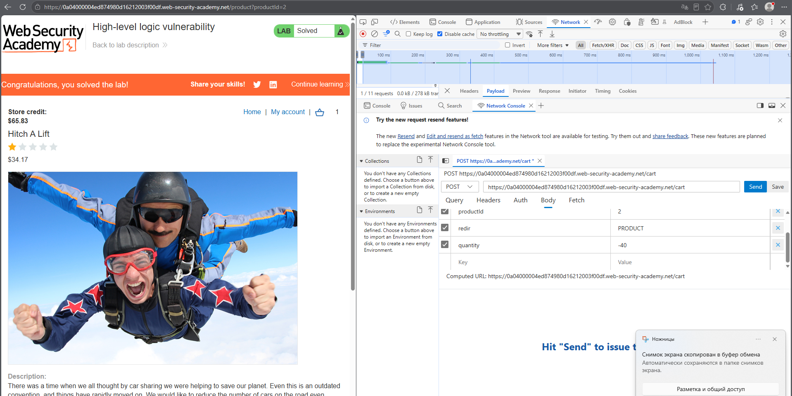
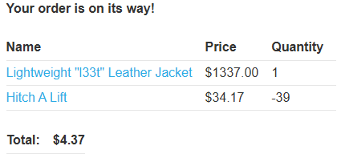
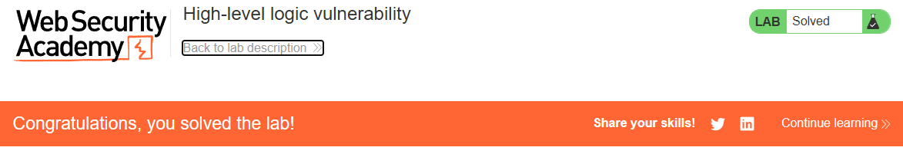

# PortSwigger Lab: High-level logic vulnerability

## Описание лаборатории
- **Платформа:** PortSwigger Web Security Academy
- **Сложность:** Apprentice
- **Цель:** Проэксплуатировать логическую ошибку в сценарии оформления покупки, чтобы купить "Lightweight l33t leather jacket" (Легкую кожаную куртку l33t) по непредусмотренной цене.

## Анализ уязвимости
Приложение неадекватно проверяет количество товаров, добавляемых в корзину. Хотя оно проверяет, что итоговая стоимость корзины не меньше нуля, оно не препятствует тому, чтобы отдельные товары имели отрицательное количество.

Добавив дешевый товар с большим отрицательным количеством, злоумышленник может снизить общую стоимость корзины. Это позволяет компенсировать высокую стоимость кожаной куртки и купить ее за часть реальной цены, при условии, что итоговая сумма остается положительной.

## Шаги эксплуатации
1. Выполнен вход в приложение с использованием предоставленных учетных данных (`wiener:peter`).
2. В корзину добавлена "Lightweight l33t leather jacket" (количество: 1, цена: $1337.00).
3. В корзину добавлен дешевый товар ("Hitch A Lift").
4. Перехвачен запрос `POST /cart` для дешевого товара с помощью инструментов разработчика браузера.
5. Параметр `quantity` изменен на большое отрицательное число (например, `-39`), и запрос отправлен.
6. Сервер рассчитал новую итоговую сумму: `$1337.00 + ($34.17 * -39) = $4.37`.
7. Выполнен переход к оформлению заказа, и заказ был размещен, что позволило успешно купить куртку за $4.37.

## Доказательства

### Запрос с измененным количеством

### Корзина с отрицательным количеством и сниженной суммой

### Лаборатория решена

## Меры защиты (Mitigation)
Для предотвращения этой уязвимости приложение должно применять строгую валидацию ко всем числовым вводам.
1. **Проверка положительного количества:** Сервер должен отклонять любой запрос, в котором количество товара меньше или равно нулю.
2. **Серверные вычисления:** Сервер должен всегда пересчитывать итоговую стоимость на основе допустимых количеств, хранящихся в базе данных, а не доверять значениям, отправленным клиентом.