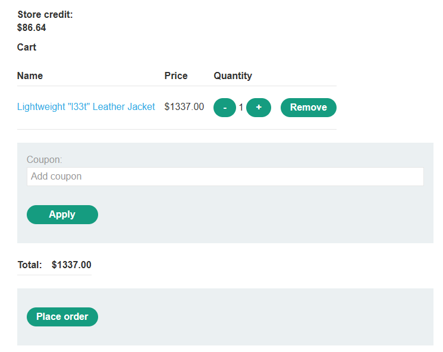
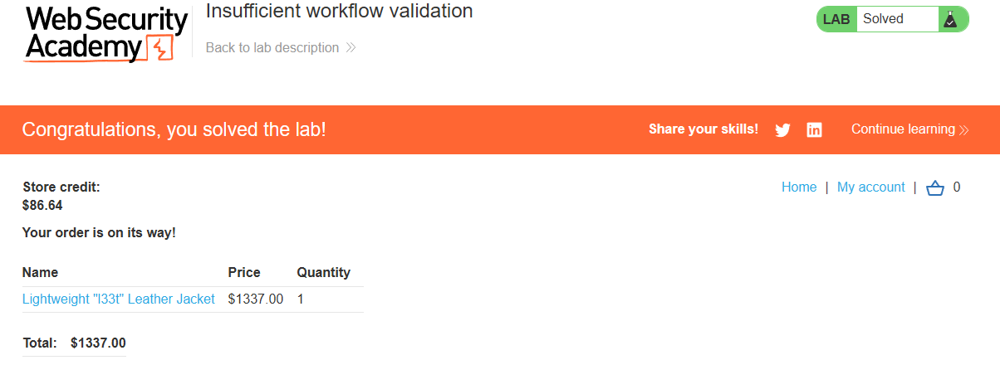

# PortSwigger Lab: Insufficient workflow validation

## Lab Description
- **Platform:** PortSwigger Web Security Academy
- **Difficulty:** Practitioner
- **Objective:** Exploit a flaw in the purchasing workflow to buy a "Lightweight l33t leather jacket".

## Vulnerability Analysis
The application makes flawed assumptions about the sequence of events in the purchasing workflow. It assumes that users will always follow the intended path: add to cart, proceed to checkout, and confirm the order. 

However, the server does not properly validate whether the payment step was actually completed before confirming the order. The endpoint `/cart/order-confirmation?order-confirmed=true` can be called directly, bypassing the funds check.

## Exploitation Steps
1. Logged in to the application using the provided credentials (`wiener:peter`).
2. Added a cheap item to the cart and completed the purchase to observe the successful workflow.
3. Captured the confirmation request via DevTools: `/cart/order-confirmation?order-confirmed=true`.
4. Cleared the cart and added the expensive "Lightweight l33t leather jacket" (which exceeds the available store credit).
5. Navigated directly to the captured confirmation URL while the jacket was in the cart.
6. The server accepted the request, bypassed the insufficient funds check, and confirmed the order for the jacket.

## Evidence

### Bypassing Payment Step (Confirmation Request)

### Cart with Expensive Item

### Lab Solved

## Mitigation
To prevent this vulnerability, the application must enforce strict state machine validation on the server side.
1. **Workflow State Validation:** The server must track the state of the order (e.g., "in cart", "payment pending", "payment confirmed"). The confirmation endpoint should only be accessible if the previous step (successful payment) was completed.
2. **Do Not Trust Client Input:** Never rely solely on parameters like `order-confirmed=true` sent from the client to determine the state of a transaction.