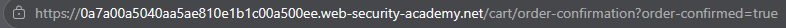
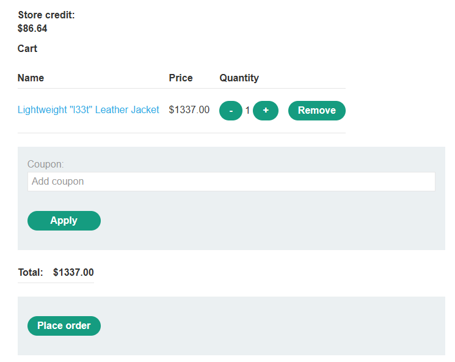
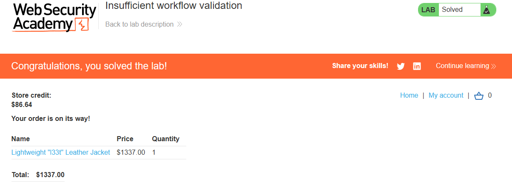

# PortSwigger Lab: Insufficient workflow validation

## Описание лаборатории
- **Платформа:** PortSwigger Web Security Academy
- **Сложность:** Practitioner
- **Цель:** Проэксплуатировать ошибку в сценарии оформления покупки, чтобы купить "Lightweight l33t leather jacket" (Легкую кожаную куртку l33t).

## Анализ уязвимости
Приложение делает ошибочные предположения о последовательности событий в сценарии оформления покупки. Оно предполагает, что пользователи всегда будут следовать заданному пути: добавление в корзину, переход к оформлению заказа и подтверждение заказа.

Однако сервер не проверяет должным образом, был ли фактически завершен этап оплаты, прежде чем подтвердить заказ. К эндпоинту `/cart/order-confirmation?order-confirmed=true` можно обратиться напрямую, минуя проверку средств.

## Шаги эксплуатации
1. Выполнен вход в приложение с использованием предоставленных учетных данных (`wiener:peter`).
2. В корзину добавлен дешевый товар, и покупка завершена, чтобы пронаблюдать успешный сценарий.
3. С помощью инструментов разработчика браузера перехвачен запрос подтверждения: `/cart/order-confirmation?order-confirmed=true`.
4. Корзина очищена, и добавлена дорогая "Lightweight l33t leather jacket" (стоимость которой превышает доступный кредит магазина).
5. Выполнен прямой переход по сохраненному URL подтверждения, пока куртка находилась в корзине.
6. Сервер принял запрос, обошел проверку на недостаток средств и подтвердил заказ на куртку.

## Доказательства

### Обход этапа оплаты (Запрос подтверждения)

### Корзина с дорогим товаром

### Лаборатория решена

## Меры защиты (Mitigation)
Для предотвращения этой уязвимости приложение должно обеспечивать строгую валидацию конечного автомата (state machine) на стороне сервера.
1. **Валидация состояния сценария:** Сервер должен отслеживать состояние заказа (например, "в корзине", "ожидает оплаты", "оплата подтверждена"). Эндпоинт подтверждения должен быть доступен только в том случае, если предыдущий этап (успешная оплата) был завершен.
2. **Не доверять вводу клиента:** Никогда не полагаться исключительно на параметры, такие как `order-confirmed=true`, отправленные клиентом, для определения состояния транзакции.