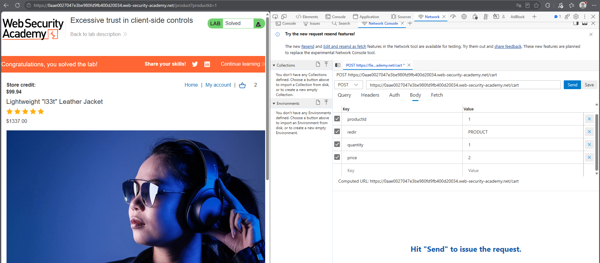
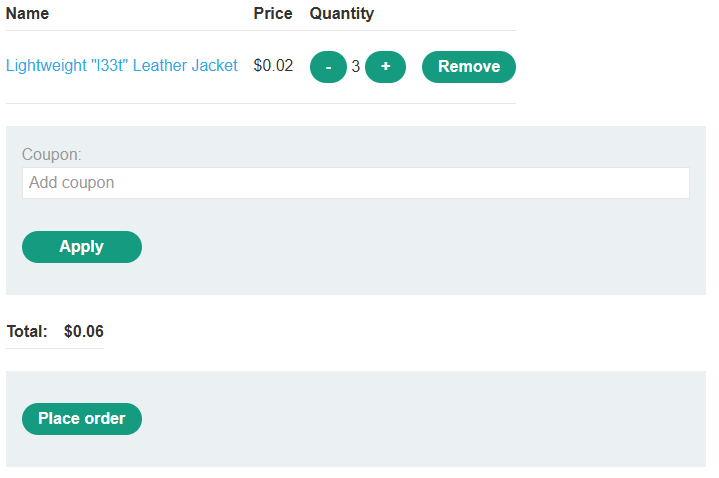

# PortSwigger Lab: Excessive trust in client-side controls

## Lab Description
- **Platform:** PortSwigger Web Security Academy
- **Difficulty:** Apprentice
- **Objective:** Exploit a logic flaw in the purchasing workflow to buy a "Lightweight l33t leather jacket" for an unintended price.

## Vulnerability Analysis
The application's purchasing workflow relies on client-side controls to determine the price of items. When a user adds a product to the cart, the client sends a POST request to `/cart` containing the `productId` and the `price`.

Because the server does not validate the price against the database, an attacker can intercept the request and modify the `price` parameter to an arbitrary value before submitting it.

## Exploitation Steps
1. Logged in to the application using the provided credentials (`wiener:peter`).
2. Navigated to the "Lightweight l33t leather jacket" product page (original price: $1337.00).
3. Clicked "Add to cart" and intercepted the `POST /cart` request using browser DevTools.
4. Modified the `price` parameter in the request body from `133700` to `2` (or `1`).
5. Sent the modified request. The server accepted the new price and added the item to the cart for $0.02.
6. Proceeded to checkout and placed the order, successfully purchasing the jacket at the manipulated price.

## Evidence

### Modified Request (Price Tampering)

### Cart with Manipulated Price

### Lab Solved

## Mitigation
To prevent this vulnerability, the server must never trust client-supplied pricing data.
1. **Server-Side Price Validation:** The server should retrieve the product's price directly from the database using the `productId` and ignore any client-provided price values.
2. **Session Integrity:** Calculate the total order value server-side and validate it during checkout.