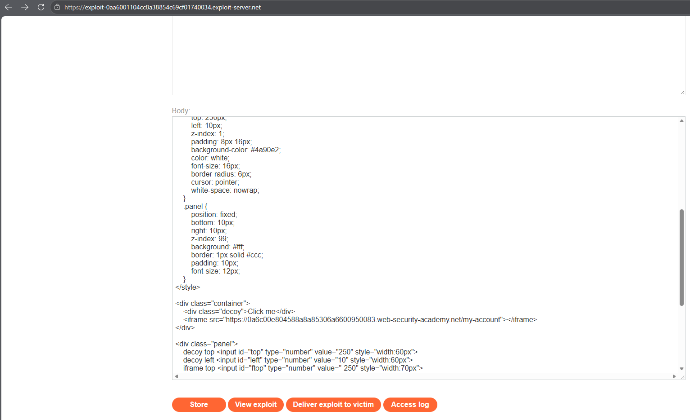
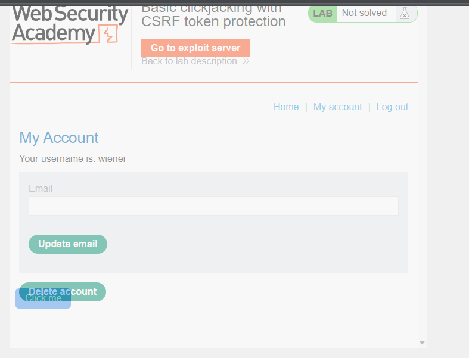
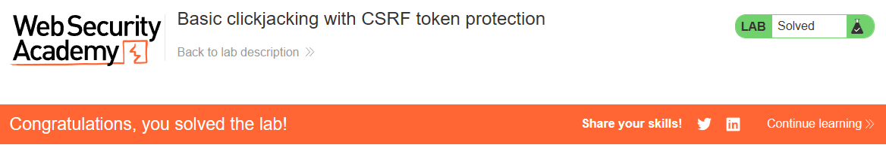

# Lab: Basic Clickjacking with CSRF Token Protection

## Vulnerability Description
The target application's account deletion function (`/my-account`) is protected by a
CSRF token, which prevents traditional cross-site request forgery attacks. However,
the page does not send any frame-embedding restrictions (`X-Frame-Options` or
`CSP frame-ancestors`), making it vulnerable to clickjacking.

Because the victim's browser automatically submits the valid CSRF token and session
cookies when the hidden form inside the iframe is triggered, the token-based CSRF
protection is entirely bypassed. The user believes they are clicking a harmless
"Click me" button, but in reality they are clicking the "Delete account" button
hidden inside the transparent iframe.

## Test Scenarios
1. Confirm the delete-account form requires a valid CSRF token (traditional CSRF fails).
2. Attempt to embed `/my-account` in an iframe (no frame restrictions observed).
3. Overlay a decoy button on the hidden "Delete account" button.
4. Verify the victim's account is deleted after clicking the decoy.

## Exploitation Steps
1. Logged in as `wiener:peter`.
2. Crafted an HTML page on the exploit server containing a transparent iframe
   pointing to `/my-account` and a decoy button labeled "Click me".
3. Calibrated the iframe position using a negative `top` offset to scroll the
   account page and reveal the "Delete account" button inside the container.
4. Adjusted the decoy button's `top` and `left` coordinates so it aligned
   precisely over the "Delete account" button.
5. Disabled debug mode (iframe opacity set to 0) and delivered the exploit.
6. The victim clicked "Click me", which triggered the real deletion form.
7. The browser submitted the request with the valid CSRF token and session cookie,
   deleting the account. The lab was marked as solved.

## Evidence

### Exploit Code

### Button Overlay (Debug Mode)

### Lab Solved

## Mitigation
- Set `X-Frame-Options: DENY` (or `SAMEORIGIN`) on all authenticated pages.
- Use `Content-Security-Policy: frame-ancestors 'none'` as a modern reinforcement.
- Require re-authentication (password confirmation) for destructive actions such
  as account deletion — this defeats clickjacking because the victim cannot see
  or fill in the password field through a transparent overlay.