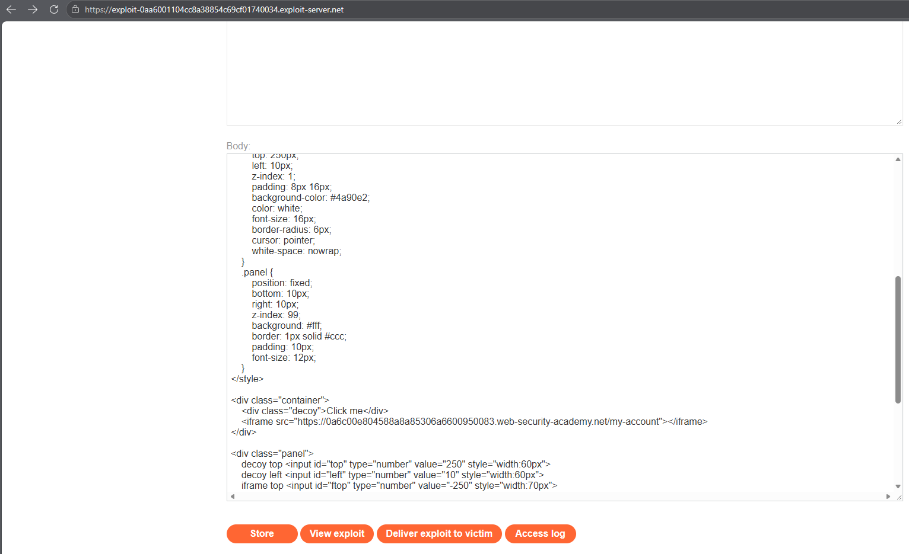
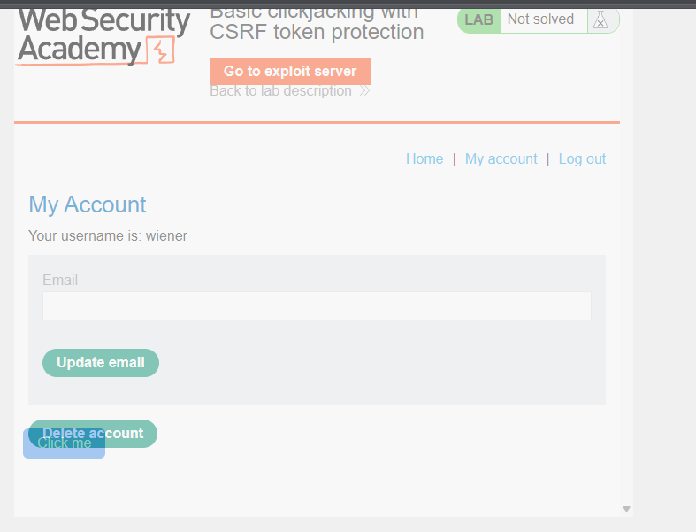
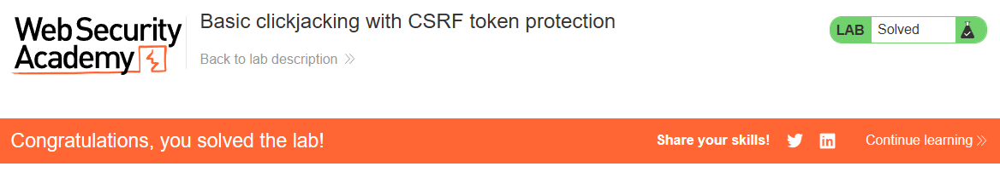

# Лабораторная работа: Базовый кликджекинг с защитой CSRF-токеном

## Описание уязвимости
Функция удаления аккаунта (`/my-account`) на целевом приложении защищена
CSRF-токеном, что предотвращает традиционные атаки межсайтовой подделки
запроса. Однако страница не отправляет никаких заголовков, ограничивающих
встраивание во фреймы (`X-Frame-Options` или `CSP frame-ancestors`), что
делает её уязвимой к кликджекингу.

Поскольку браузер жертвы автоматически подставляет валидный CSRF-токен и
cookie сессии при срабатывании скрытой формы внутри iframe, защита на
основе токенов полностью обходится. Пользователь полагает, что нажимает
безобидную кнопку «Click me», но в реальности он кликает по кнопке
«Delete account», скрытой внутри прозрачного iframe.

## Сценарии тестирования
1. Подтвердить, что форма удаления аккаунта требует валидный CSRF-токен (традиционный CSRF не работает).
2. Попытаться встроить `/my-account` в iframe (ограничения на встраивание отсутствуют).
3. Наложить кнопку-приманку поверх скрытой кнопки «Delete account».
4. Убедиться, что аккаунт жертвы удаляется после нажатия на приманку.

## Шаги эксплуатации
1. Выполнен вход как `wiener:peter`.
2. На сервере эксплойтов создана HTML-страница, содержащая прозрачный
   iframe, указывающий на `/my-account`, и кнопку-приманку «Click me».
3. Позиция iframe откалибрована с использованием отрицательного смещения
   `top`, чтобы прокрутить страницу аккаунта и показать кнопку «Delete
   account» внутри контейнера.
4. Координаты `top` и `left` кнопки-приманки скорректированы так, чтобы
   она точно совпала с кнопкой «Delete account».
5. Режим отладки отключён (opacity iframe установлен в 0), эксплойт доставлен.
6. Жертва нажала «Click me», что инициировало реальную форму удаления.
7. Браузер отправил запрос с валидным CSRF-токеном и cookie сессии,
   удалив аккаунт. Лабораторная работа помечена как решённая.

## Доказательства

### Код эксплойта

### Наложение кнопок (режим отладки)

### Лабораторная работа решена

## Меры по устранению
- Установить `X-Frame-Options: DENY` (или `SAMEORIGIN`) на всех аутентифицированных страницах.
- Использовать `Content-Security-Policy: frame-ancestors 'none'` как современное усиление.
- Требовать повторную аутентификацию (подтверждение пароля) для деструктивных
  действий, таких как удаление аккаунта — это побеждает кликджекинг, поскольку
  жертва не может увидеть или заполнить поле пароля через прозрачное наложение.