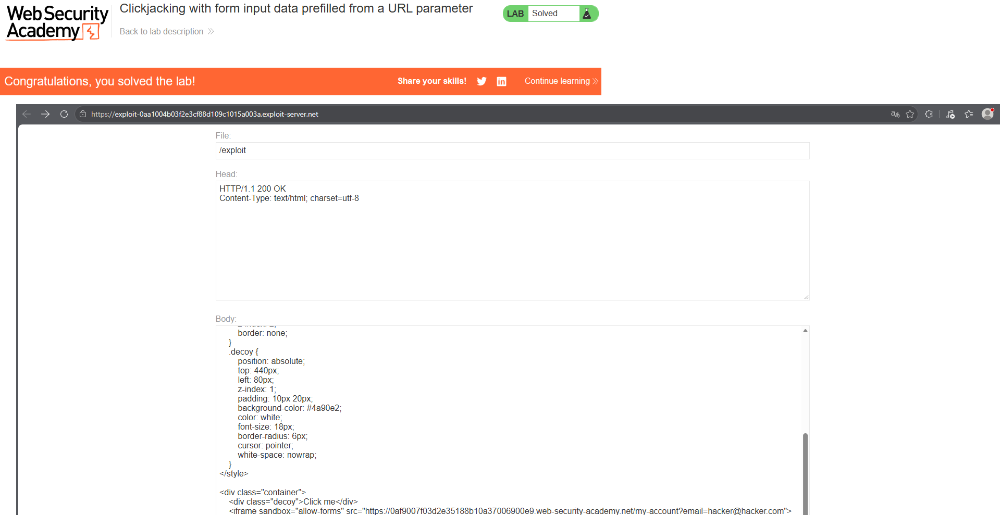
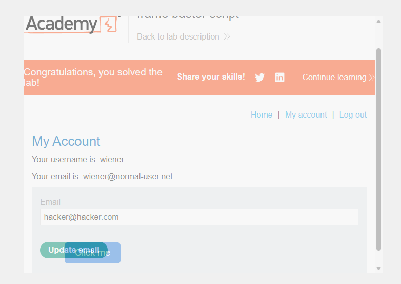
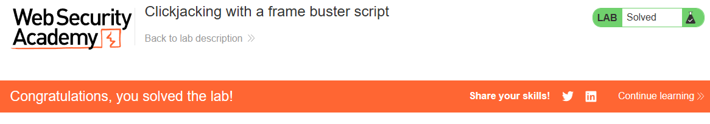

# PortSwigger Lab: Clickjacking with a frame buster script

## Lab Description
- **Platform:** PortSwigger Web Security Academy
- **Difficulty:** Apprentice
- **Objective:** Bypass the frame buster script and conduct a clickjacking attack that changes the user's email address.

## Vulnerability Analysis
The application implements a frame buster script (JavaScript) designed to prevent the page from being embedded in an `iframe`. The script checks if the page is the top-level window and, if not, redirects the top window to the current page, effectively breaking out of the frame.

However, this defense can be bypassed by adding the `sandbox` attribute to the `<iframe>` element. By using `sandbox="allow-forms"`, the browser blocks the execution of the frame buster script (and any other JavaScript inside the iframe), but still allows the form submission to work.

## Exploitation Steps
1. Logged in to the application using the provided credentials (`wiener:peter`).
2. Crafted an HTML page with a decoy button ("Click me") and an `iframe` targeting the vulnerable `/my-account` page.
3. Added the `sandbox="allow-forms"` attribute to the `iframe` to disable the frame buster script while allowing form submission.
4. Prefilled the email field using the URL parameter: `?email=hacker@hacker.com`.
5. Used CSS to position the decoy button exactly over the "Update email" button and set the `iframe` opacity to `0.0001`.
6. Delivered the exploit to the victim. The click on the decoy button successfully updated the victim's email address.

## Evidence

### Exploit Code (with sandbox bypass)

### Overlay Calibration

### Lab Solved

## Mitigation
To effectively prevent Clickjacking, frame busting scripts should not be relied upon as the sole defense.
1. **X-Frame-Options:** Set the header to `DENY` or `SAMEORIGIN`.
2. **CSP frame-ancestors:** Use the `Content-Security-Policy: frame-ancestors 'none'` directive.
3. **Avoid JavaScript-based protection:** Frame busting can be bypassed using the `sandbox` attribute, so HTTP headers are the reliable solution.