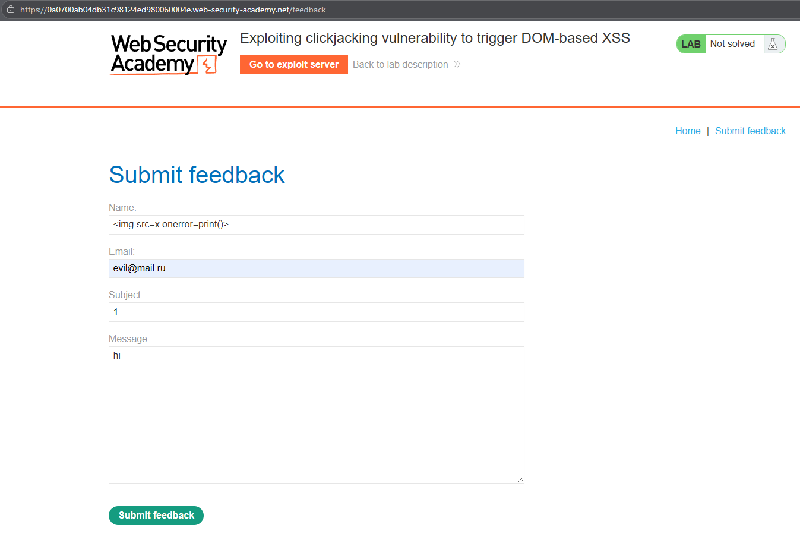
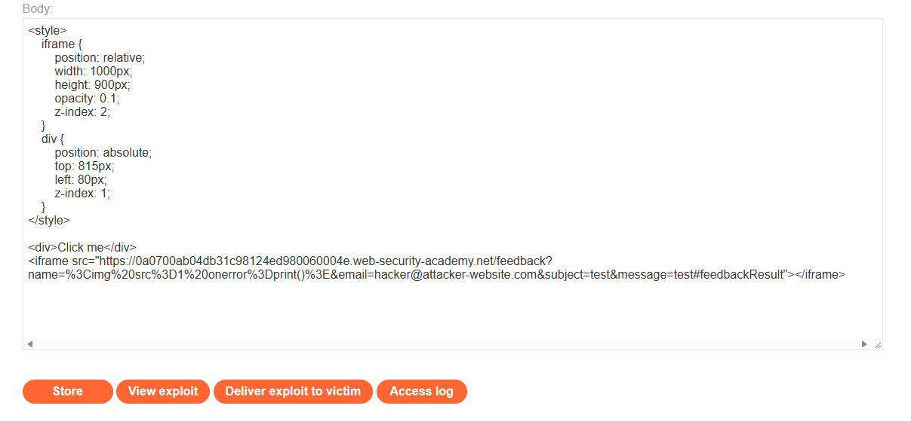
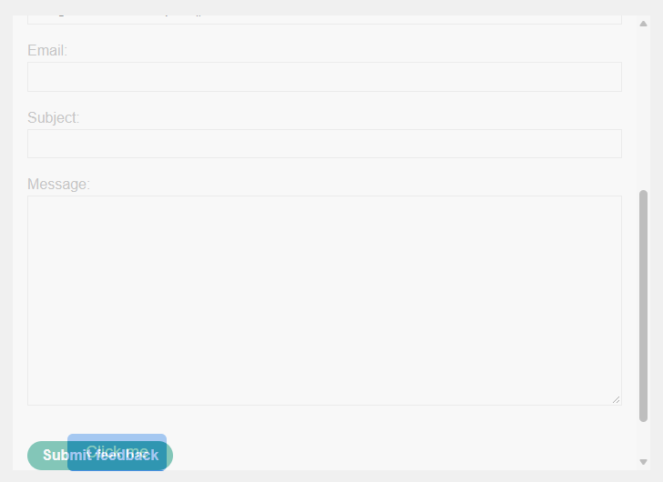
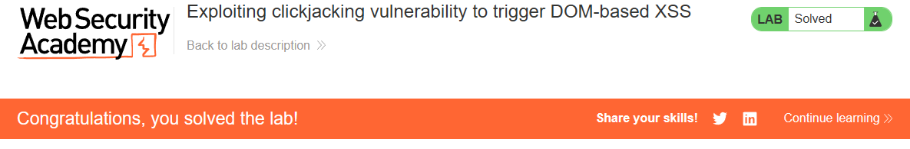

# Lab: Exploiting Clickjacking to Trigger DOM-Based XSS

## Vulnerability Description
The target application contains a DOM-based XSS vulnerability in the "Submit
feedback" form: the value of the `name` URL parameter is reflected into the
page's DOM without sanitization. An attacker can inject an `` tag with an
`onerror` handler that calls `print()`, but the payload only fires when the
form is actually submitted — which requires a user click.

This is chained with clickjacking: the feedback page has no frame-embedding
restrictions, so the attacker can embed it in a transparent iframe with the
XSS payload pre-filled in the URL. A decoy button is overlaid on the hidden
"Submit feedback" button, so the victim's click both submits the form and
triggers the reflected XSS, executing `print()` in the victim's browser.

## Test Scenarios
1. Confirm the `name` parameter is reflected into the DOM unsanitized.
2. Verify an `` payload fires on manual form submission.
3. Embed the pre-filled feedback page in an iframe (no frame restrictions).
4. Overlay a decoy on the hidden "Submit feedback" button and confirm the
   click triggers the XSS without any user knowledge.

## Exploitation Steps
1. Visited `/feedback` and submitted `name=`.
2. Confirmed the reflected payload executed `print()` (dialog appeared),
   proving the DOM-based XSS exists independently of clickjacking.
3. On the exploit server, crafted HTML with a transparent iframe pointing to
   `/feedback?name=&email=...&subject=test&message=test#feedbackResult`.
4. Sized the iframe to 1000x900px and positioned the decoy at `top: 815px`,
   `left: 80px` so it aligned over the "Submit feedback" button.
5. Calibrated in debug mode (opacity 0.1), then set opacity to 0.0001.
6. Stored the exploit and clicked "Click me" — the print dialog opened,
   confirming the chained attack works on the attacker's own browser.
7. Delivered the exploit to the victim; the click submitted the pre-filled
   form and triggered `print()` in the victim's session. Lab solved.

## Evidence

### DOM-Based XSS Confirmed (Manual Submission)

### Exploit Code

### Button Overlay (Debug Mode)

### Lab Solved

## Mitigation
- Sanitize and HTML-encode reflected input before inserting it into the DOM;
  never use raw `innerHTML` with user-controlled data (fixes the XSS sink).
- Set `X-Frame-Options: DENY` and `Content-Security-Policy: frame-ancestors
  'none'` to block iframe embedding (fixes the clickjacking layer).
- Require user intent for form submission (e.g. a confirmation step), so a
  single blind click cannot both submit and execute injected code.