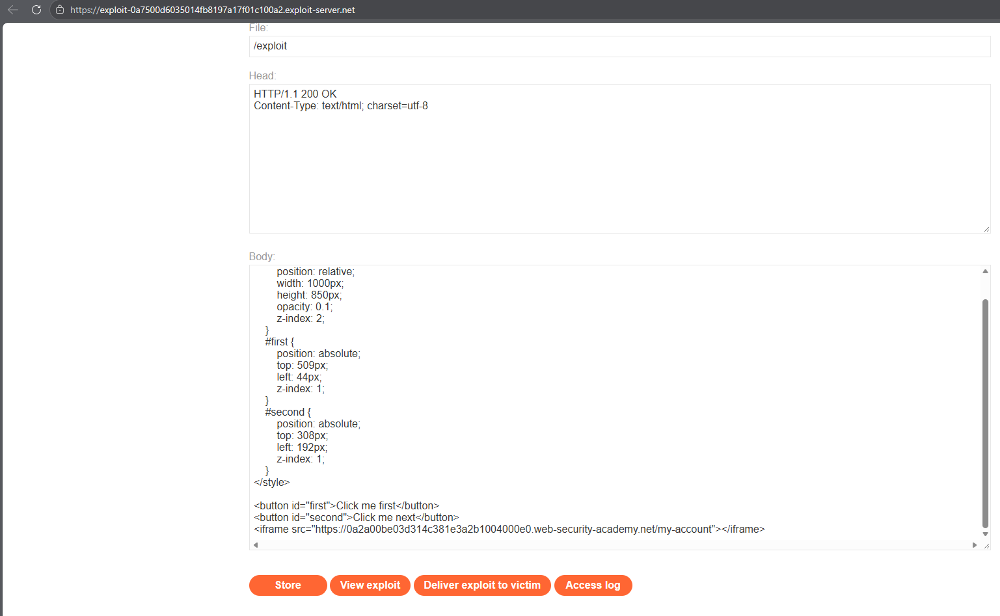
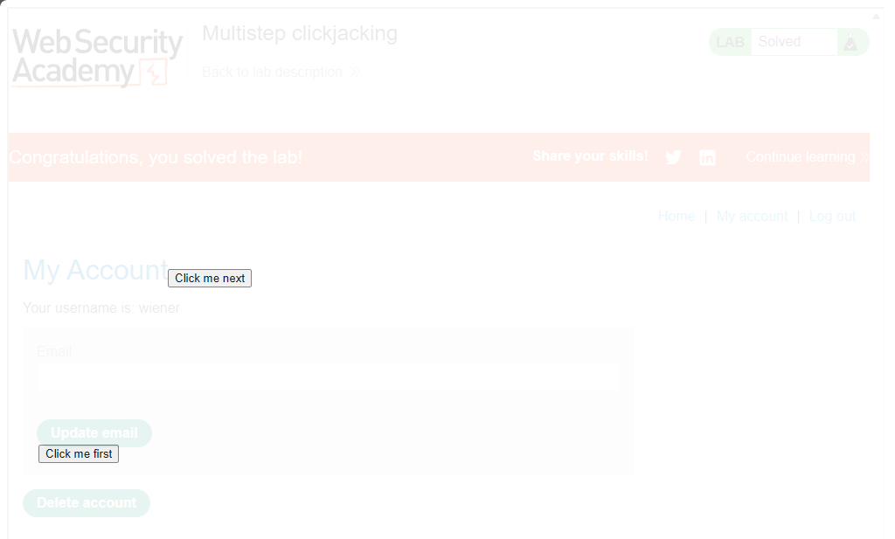
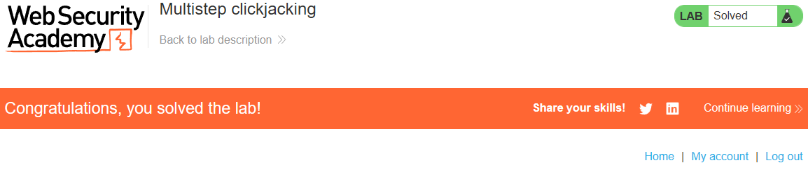

# Lab: Multistep Clickjacking

## Vulnerability Description
The target application's account deletion function is protected by a CSRF
token and an additional confirmation dialog ("Are you sure?"), which is
designed to defeat single-step clickjacking. However, the page sends no
frame-embedding restrictions (`X-Frame-Options` or CSP `frame-ancestors`),
so it remains vulnerable to a multistep clickjacking attack.

The key insight is that both decoy buttons are placed on the exploit page
simultaneously — no JavaScript is required to swap them. The first decoy
overlays the "Delete account" button; when the victim clicks it, the iframe
submits the form and reloads to the confirmation dialog. The second decoy,
already positioned at the dialog's coordinates, now lines up exactly with
the "Yes" button, so the victim's second click confirms the deletion.

## Test Scenarios
1. Confirm the delete action requires both a valid CSRF token and a
   confirmation click (single-step CSRF and clickjacking both fail).
2. Verify the `/my-account` page can be embedded in an iframe.
3. Overlay two decoys: one on "Delete account", one on the "Yes" button
   that appears after the first submission.
4. Confirm that two consecutive clicks on the decoys delete the account.

## Exploitation Steps
1. Logged in as `wiener:peter` and studied the delete-account workflow,
   noting the confirmation dialog that follows the first click.
2. Crafted an HTML payload on the exploit server with a transparent iframe
   pointing to `/my-account` and two absolutely-positioned decoy buttons.
3. Calibrated the first decoy (`top: 509px`, `left: 44px`) over the
   "Delete account" button using debug opacity `0.1`.
4. Calibrated the second decoy (`top: 308px`, `left: 192px`) over the
   "Yes" button that the confirmation dialog renders in the iframe.
5. Set the iframe opacity to `0.0001` so the victim sees only the decoys.
6. Stored the exploit and delivered it to the victim.
7. The victim's two clicks on the decoys triggered the real buttons inside
   the iframe, deleting the account and solving the lab.

## Evidence

### Exploit Code

### Button Overlay (Debug Mode)

### Lab Solved

> Note: On the solved screenshot the decoy buttons appear misaligned
> relative to the target controls. This is expected — after the victim's
> clicks deleted the account, the iframe reloaded to the post-deletion
> state, so the original calibration coordinates no longer match the new
> DOM. Correct alignment is proven by the debug-mode overlay screenshot
> above, taken before delivery.

## Mitigation
- Implement `X-Frame-Options: DENY` or `Content-Security-Policy:
  frame-ancestors 'none'` to prevent the page from being embedded in any
  iframe, which defeats every step of the multistep attack at once.
- Require re-authentication (e.g. password entry) for destructive actions,
  since a blind click overlay cannot fill in a password field.