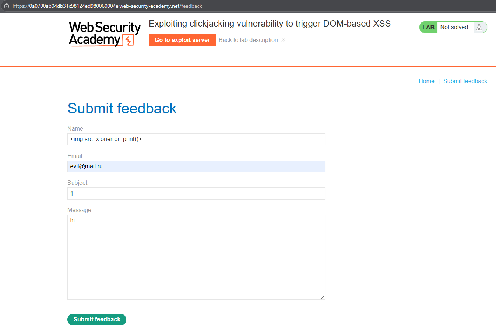
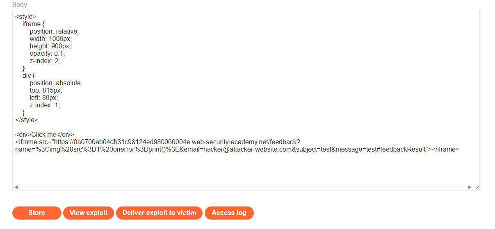
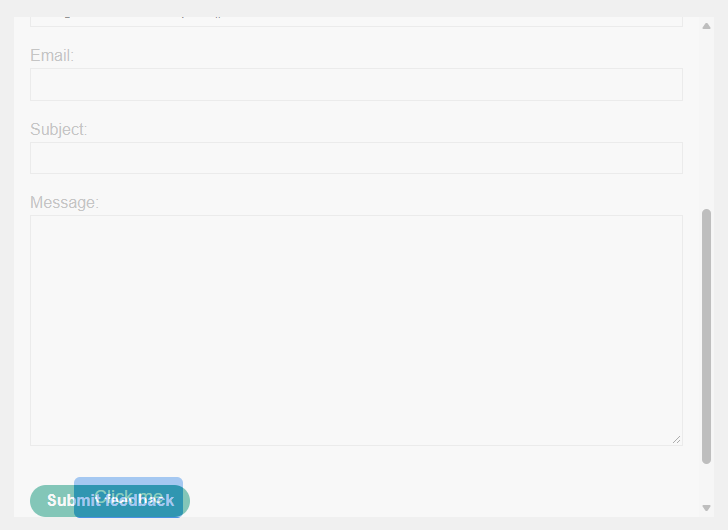
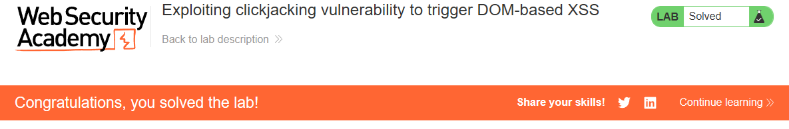

# Лабораторная работа: Эксплуатация кликджекинга для запуска DOM-based XSS

## Описание уязвимости
Целевое приложение содержит DOM-based XSS уязвимость в форме «Submit
feedback»: значение URL-параметра `name` отражается в DOM страницы без
санитизации. Злоумышленник может внедрить тег `` с обработчиком
`onerror`, вызывающим `print()`, но payload срабатывает только при реальной
отправке формы — а для этого нужен клик пользователя.

Это объединено с кликджекингом: страница feedback не имеет ограничений на
встраивание во фреймы, поэтому злоумышленник может встроить её в прозрачный
iframe с XSS-payload, предзаполненным в URL. Кнопка-приманка наложена на
скрытую кнопку «Submit feedback», так что клик жертвы одновременно отправляет
форму и запускает отражённый XSS, выполняя `print()` в браузере жертвы.

## Сценарии тестирования
1. Подтвердить, что параметр `name` отражается в DOM без санитизации.
2. Проверить, что payload `` срабатывает при ручной
   отправке формы.
3. Встроить предзаполненную страницу feedback в iframe (ограничений нет).
4. Наложить приманку на скрытую кнопку «Submit feedback» и подтвердить, что
   клик запускает XSS без ведома пользователя.

## Шаги эксплуатации
1. Перешли на `/feedback` и отправили `name=`.
2. Подтвердили, что отражённый payload выполнил `print()` (появился диалог),
   доказав наличие DOM-based XSS независимо от кликджекинга.
3. На сервере эксплойтов создали HTML с прозрачным iframe, указывающим на
   `/feedback?name=&email=...&subject=test&message=test#feedbackResult`.
4. Задали iframe размер 1000x900px и разместили приманку на `top: 815px`,
   `left: 80px`, чтобы она совпала с кнопкой «Submit feedback».
5. Откалибровали в режиме отладки (opacity 0.1), затем поставили opacity 0.0001.
6. Сохранили эксплойт и нажали «Click me» — открылся диалог печати, что
   подтвердило работу цепочки в браузере самого атакующего.
7. Доставили эксплойт жертве; клик отправил предзаполненную форму и запустил
   `print()` в сессии жертвы. Лабораторная работа решена.

## Доказательства

### Подтверждение DOM-Based XSS (ручная отправка)

### Код эксплойта

### Наложение кнопок (режим отладки)

### Лабораторная работа решена

> Примечание: на скриншоте решённой лабы кнопка-приманка выглядит смещённой
> относительно целевого элемента. Это ожидаемо — после клика жертвы форма
> отправилась и iframe перезагрузился, показав результат с XSS-payload,
> поэтому исходные координаты калибровки больше не совпадают с новым DOM.
> Корректность наложения подтверждается скриншотом в режиме отладки
> (12-clickjacking-overlay.png), сделанным до доставки эксплойта.

## Меры по устранению
- Санитизировать и HTML-кодировать отражаемый ввод перед вставкой в DOM;
  никогда не использовать сырой `innerHTML` с данными пользователя (закрывает
  XSS-сток).
- Установить `X-Frame-Options: DENY` и `Content-Security-Policy: frame-ancestors
  'none'`, чтобы блокировать встраивание в iframe (закрывает слой кликджекинга).
- Требовать явное намерение пользователя для отправки формы (например шаг
  подтверждения), чтобы один слепой клик не мог одновременно отправить форму
  и выполнить внедрённый код.