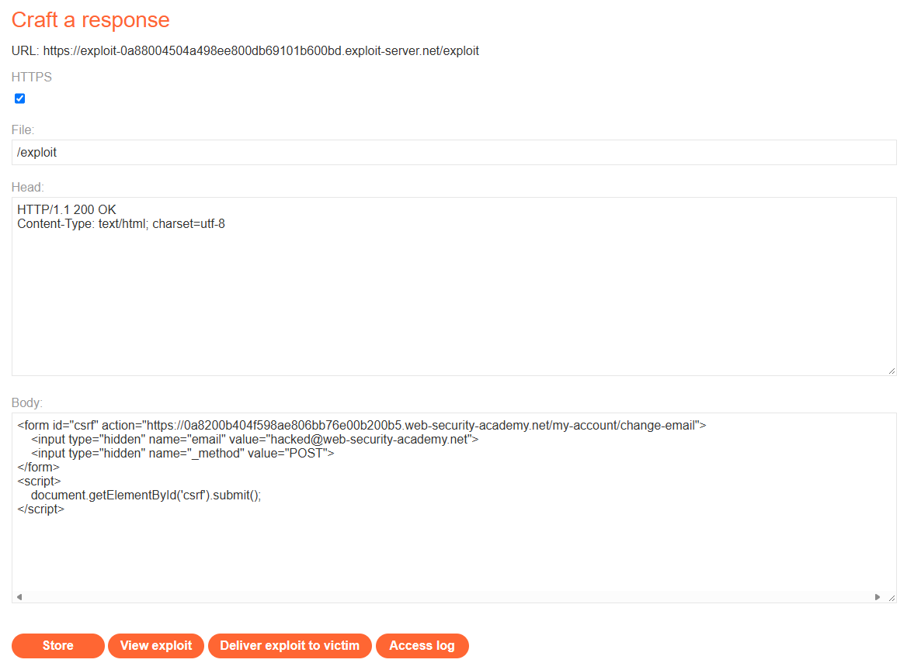
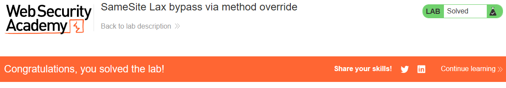

# PortSwigger Lab: SameSite Lax bypass via method override

## Описание лаборатории
- **Платформа:** PortSwigger Web Security Academy
- **Сложность:** Practitioner
- **Цель:** Создать HTML-страницу, использующую CSRF-атаку для изменения email-адреса зрителя, и загрузить ее на сервер эксплойтов.

## Анализ уязвимости
Сессионная кука приложения настроена с атрибутом `SameSite=Lax`. Это предотвращает отправку куки браузером при межсайтовых `POST`-запросах, что защищает от классических CSRF-атак.

Однако `SameSite=Lax` по-прежнему разрешает отправку куки при межсайтовых `GET`-запросах (например, когда пользователь кликает по ссылке или происходит редирект). Приложение также поддерживает функционал «переопределения метода» (method override), позволяя `GET`-запросу обрабатываться на сервере как `POST`-запрос, если присутствует параметр `_method`.

Злоумышленник может эксплуатировать это, заставив браузер жертвы отправить `GET`-запрос (который включает куку), но добавив параметр `_method=POST`, чтобы сервер обработал его как запрос, изменяющий состояние.

## Шаги эксплуатации
1. Выполнен вход в приложение с предоставленными учетными данными (`wiener:peter`).
2. Выполнен переход на сервер эксплойтов (Exploit Server) для создания вредоносной HTML-страницы.
3. Поскольку `SameSite=Lax` блокирует межсайтовые `POST`-запросы, но разрешает `GET`, форма была настроена на использование `GET` по умолчанию (путем удаления атрибута `method="POST"`).
4. Форма содержит параметр `_method=POST` для обхода серверной проверки метода:
   ```html
   <form id="csrf" action="https://YOUR-LAB-ID.web-security-academy.net/my-account/change-email">
       <input type="hidden" name="email" value="hacked@web-security-academy.net">
       <input type="hidden" name="_method" value="POST">
   </form>
   <script>
       document.getElementById('csrf').submit();
   </script>
   ```
5. Эксплойт сохранен и доставлен жертве. Браузер жертвы отправил `GET`-запрос (прикрепив сессионную куку), но сервер обработал его как `POST` из-за параметра `_method`, изменив email жертвы.

## Доказательства

### Код эксплойта


### Лаборатория решена


## Меры защиты (Mitigation)
Для предотвращения этого обхода приложение не должно разрешать переопределение метода для `GET`-запросов.
1. **Ограничение переопределения метода:** Разрешать использование параметра `_method` для переопределения метода только в том случае, если исходный запрос был `POST` (например, `method="POST"`).
2. **CSRF-токены:** Внедрить CSRF-токены для всех запросов, изменяющих состояние, независимо от используемого HTTP-метода. Это предотвращает атаку, даже если переопределение метода используется неправильно.