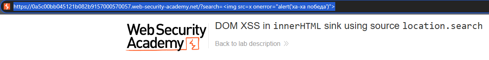

# PortSwigger Lab: DOM XSS in innerHTML sink using source location.search

## Lab Description
- **Platform:** PortSwigger Web Security Academy
- **Difficulty:** Apprentice
- **Objective:** Perform a DOM-based cross-site scripting attack that calls the `alert` function.

## Vulnerability Analysis
This lab contains a DOM-based XSS vulnerability in the search blog functionality. 
- **Source:** The application uses `location.search` to read the search query from the URL.
- **Sink:** The application uses the `innerHTML` assignment to write the search query into a `<div>` element.

Because `innerHTML` interprets the input as HTML, an attacker can inject a malicious tag with an event handler to execute JavaScript.

## Exploitation Steps
1. Injected the following payload into the search field:
   ```html
   
   ```
2. The application reflected the payload into the DOM via `innerHTML`.
3. The browser attempted to load the image `x`, failed, and triggered the `onerror` event.
4. The JavaScript was executed, triggering the custom `alert` message.

## Evidence

### Payload Injection


### Alert Execution & Lab Solved


## Mitigation
To prevent DOM XSS, the application must avoid unsafe DOM APIs. The `innerHTML` sink should be replaced with `textContent`, which treats the input as plain text and prevents HTML/JS execution.