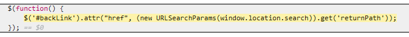
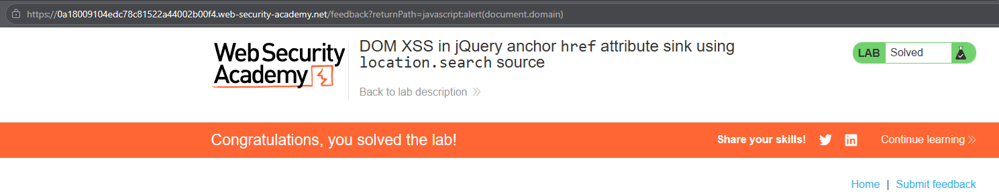

# PortSwigger Lab: DOM XSS in jQuery anchor href attribute sink using location.search source

## Lab Description
- **Platform:** PortSwigger Web Security Academy
- **Difficulty:** Apprentice
- **Objective:** Perform a DOM-based cross-site scripting attack that calls the `alert` function.

## Vulnerability Analysis
This lab contains a DOM-based XSS vulnerability in the "Submit feedback" functionality.
- **Source:** The application uses `location.search` (specifically the `returnPath` parameter) to read data from the URL.
- **Sink:** The application passes this data directly into the `href` attribute of an anchor tag (`#backLink`) using jQuery's `.attr()` method.

Because the `href` attribute accepts the `javascript:` pseudo-protocol, an attacker can inject arbitrary JavaScript that will execute when the victim clicks the "Back" link.

Vulnerable code snippet:
```javascript
$('#backLink').attr("href", (new URLSearchParams(window.location.search)).get('returnPath'));
```

## Exploitation Steps
1. Appended the following payload to the lab URL:
   ```text
   ?returnPath=javascript:alert(document.domain)
   ```
2. The browser loaded the page, and the client-side JavaScript extracted the `returnPath` value and assigned it to the `#backLink` element's `href`.
3. Clicked the "Back" link, which triggered the execution of the injected `javascript:` payload.

## Evidence

### Vulnerable Code


### Exploitation & Lab Solved


## Mitigation
To prevent this DOM XSS, the application must validate and sanitize the URL before passing it to a dangerous sink.
1. **Safe Protocols:** Implement a whitelist of allowed protocols (e.g., `http:`, `https:`). If the URL starts with `javascript:`, it must be rejected.
2. **Safe DOM APIs (Alternative):** If the value is only needed for display, use `.text()` instead of `.attr("href", ...)`.