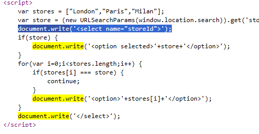

# PortSwigger Lab: DOM XSS in document.write sink using source location.search inside a select element

## Lab Description
- **Platform:** PortSwigger Web Security Academy
- **Difficulty:** Practitioner
- **Objective:** Perform a DOM-based cross-site scripting attack that calls the `alert` function.

## Vulnerability Analysis
This lab contains a DOM-based XSS vulnerability in the stock checker functionality.
- **Source:** The application uses `location.search` (specifically the `storeId` parameter) to read the selected store from the URL.
- **Sink:** The application passes this data directly into the `document.write()` function to generate an `<option>` tag inside a `<select>` element.

Because `document.write()` parses strings as HTML, an attacker can break out of the `<select>` context by injecting a closing tag and create arbitrary HTML elements with event handlers.

Vulnerable code snippet:
```javascript
var store = (new URLSearchParams(window.location.search)).get('storeId');
document.write('<select name="storeId">');
if(store) {
    document.write('<option selected>' + store + '</option>');
}
// ...
document.write('</select>');
```

## Exploitation Steps
1. Appended the `storeId` parameter to the product page URL with a payload designed to break out of the select element:
   ```text
   &storeId=</select>
   ```
2. The browser loaded the page, and the client-side JavaScript extracted the `storeId` value.
3. The `document.write()` function parsed the input. The `</select>` tag closed the dropdown menu, and the `` tag was created in the DOM.
4. The browser failed to load the image `x`, triggering the `onerror` event, which executed `alert(1)`.

## Evidence

### Vulnerable Code


### Payload in URL


### Successful Exploitation & Lab Solved


## Mitigation
To prevent this DOM XSS, the application must avoid passing untrusted data into `document.write()`.
1. **Safe DOM APIs:** Use `document.createElement()` and `textContent` to safely insert dynamic data without parsing it as HTML.
2. **Contextual Output Encoding:** If data must be written into HTML, strictly encode `<`, `>`, `"`, and `'` characters to their HTML entities (e.g., `&lt;`, `&gt;`).