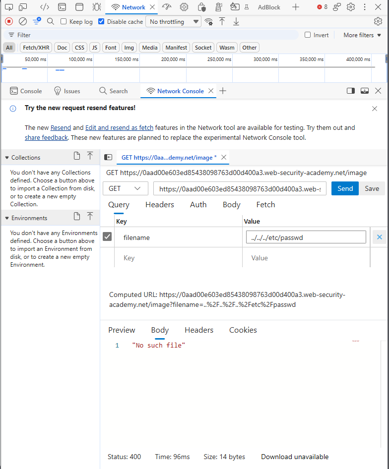

# PortSwigger Lab: File path traversal, simple case

## Lab Description
- **Platform:** PortSwigger Web Security Academy
- **Difficulty:** Apprentice
- **Objective:** Retrieve the contents of the `/etc/passwd` file.

## Vulnerability Analysis
The application's image loading functionality (`/image?filename=`) takes a user-supplied filename and appends it to a base directory without validating the final path. 

Because there is no normalization or prefix validation, an attacker can use traversal sequences (`../`) to escape the image directory and read arbitrary files on the server's file system.

## Exploitation Steps
1. Navigated to a product page and intercepted the image request via DevTools: `GET /image?filename=20.jpg`.
2. Modified the `filename` parameter to traverse up the directory tree and target the `/etc/passwd` file:
   ```text
   ../../../etc/passwd
   ```
3. Sent the request. The server resolved the path and returned the contents of `/etc/passwd`, including the `root:x:0:0:` entry.

## Evidence

### Exploit Request and Response


### Lab Solved


## Mitigation
To prevent this vulnerability, the application must normalize the file path and validate it against the allowed base directory.
1. **Path Normalization:** Use a function like `os.path.realpath()` to resolve the absolute path.
2. **Prefix Validation:** Ensure that the resolved path starts with the intended base directory (e.g., `/var/www/images`). If it does not, reject the request.