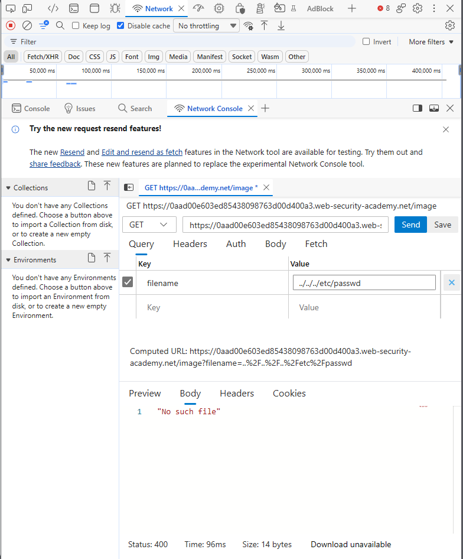
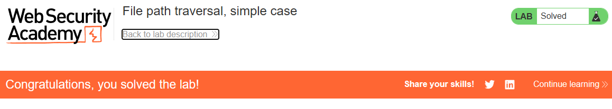

# PortSwigger Lab: File path traversal, simple case

## Описание лаборатории
- **Платформа:** PortSwigger Web Security Academy
- **Сложность:** Apprentice
- **Цель:** Получить содержимое файла `/etc/passwd`.

## Анализ уязвимости
Функционал загрузки изображений (`/image?filename=`) принимает имя файла от пользователя и добавляет его к базовой директории без проверки итогового пути.

Поскольку отсутствует нормализация и проверка префикса, злоумышленник может использовать последовательности обхода (`../`), чтобы выйти из директории с изображениями и прочитать произвольные файлы в файловой системе сервера.

## Шаги эксплуатации
1. Выполнен переход на страницу товара, и с помощью инструментов разработчика браузера перехвачен запрос на загрузку изображения: `GET /image?filename=20.jpg`.
2. Параметр `filename` изменен для выхода вверх по дереву директорий и нацеливания на файл `/etc/passwd`:
   ```text
   ../../../etc/passwd
   ```
3. Запрос отправлен. Сервер разрешил путь и вернул содержимое `/etc/passwd`, включая запись `root:x:0:0:`.

## Доказательства

### Запрос эксплойта и ответ


### Лаборатория решена


## Меры защиты (Mitigation)
Для предотвращения этой уязвимости приложение должно нормализовать путь к файлу и проверять его на соответствие разрешенной базовой директории.
1. **Нормализация пути:** Использовать функцию вроде `os.path.realpath()` для получения абсолютного пути.
2. **Проверка префикса:** Убедиться, что итоговый путь начинается с предполагаемой базовой директории (например, `/var/www/images`). Если это не так, отклонить запрос.