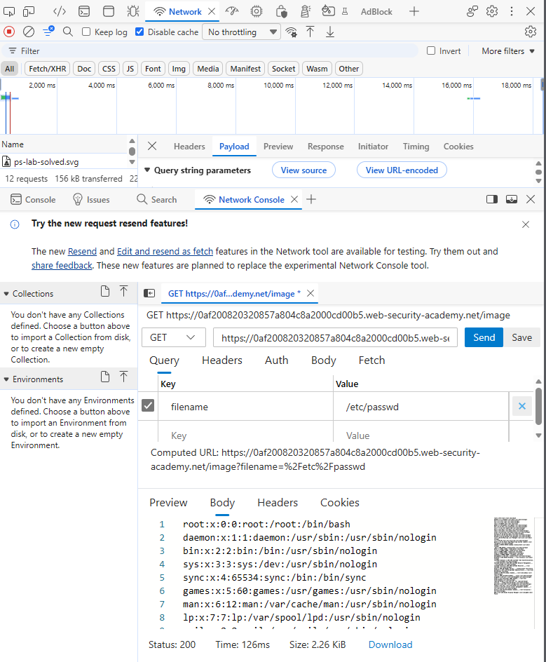
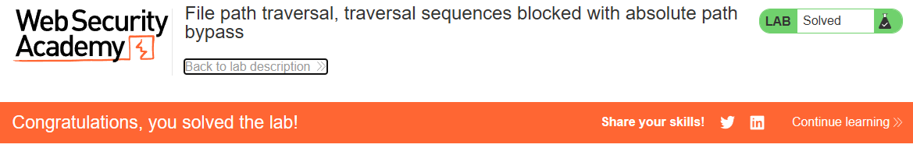

# PortSwigger Lab: File path traversal, traversal sequences blocked with absolute path bypass

## Описание лаборатории
- **Платформа:** PortSwigger Web Security Academy
- **Сложность:** Practitioner
- **Цель:** Получить содержимое файла `/etc/passwd`. Приложение блокирует последовательности обхода (`../`), но рассматривает предоставленное имя файла как относительное от рабочей директории по умолчанию.

## Анализ уязвимости
В приложении реализован наивный фильтр, который блокирует последовательности обхода (`../`) в параметре `filename`. Однако приложение не учитывает абсолютные пути.

Поскольку сервер разрешает предоставленное имя файла относительно текущей рабочей директории, передача абсолютного пути (например, `/etc/passwd`) позволяет злоумышленнику обойти фильтр и получить доступ к произвольным файлам в системе.

## Шаги эксплуатации
1. С помощью инструментов разработчика браузера перехвачен запрос на загрузку изображения (`GET /image?filename=...`).
2. Предпринята попытка использования стандартного пейлоада обхода (`../../../etc/passwd`), который был заблокирован фильтром.
3. Фильтр обойден путем передачи абсолютного пути:
   ```text
   /etc/passwd
   ```
4. Запрос отправлен. Сервер проигнорировал заблокированные последовательности обхода и вернул содержимое `/etc/passwd`.

## Доказательства

### Запрос эксплойта (Абсолютный путь)


### Лаборатория решена


## Меры защиты (Mitigation)
Для предотвращения этой уязвимости приложение должно проверять итоговый разрешенный путь на соответствие белому списку разрешенных директорий.
1. **Нормализация пути:** Использовать функцию вроде `os.path.realpath()` для разрешения абсолютных и относительных путей.
2. **Проверка префикса:** Проверять, что итоговый путь начинается с предполагаемой базовой директории. Отклонять любые пути (абсолютные или относительные), которые разрешаются вне её.
3. **Валидация ввода:** Убедиться, что пользовательский ввод не начинается с разделителя пути (`/` или `\`), если абсолютные пути явно не разрешены.