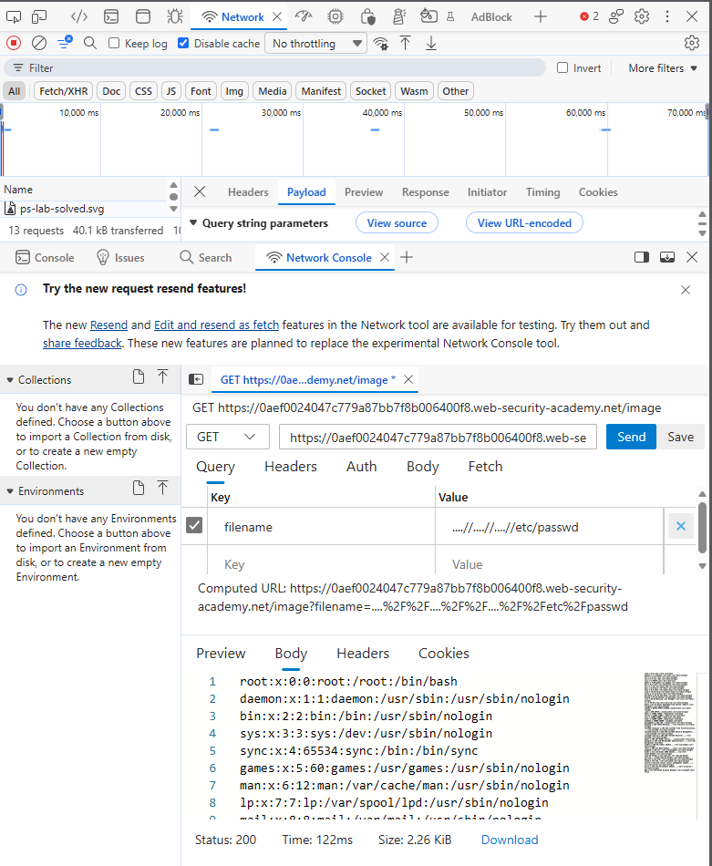
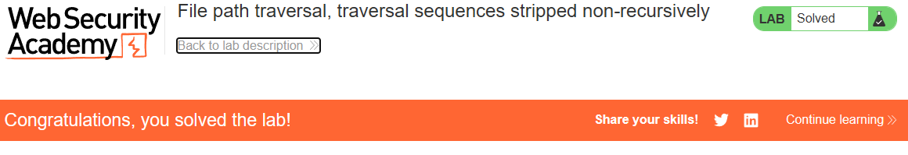

    # PortSwigger Lab: File path traversal, traversal sequences stripped non-recursively

## Описание лаборатории
- **Платформа:** PortSwigger Web Security Academy
- **Сложность:** Practitioner
- **Цель:** Получить содержимое файла `/etc/passwd`. Приложение удаляет последовательности обхода путей из предоставленного пользователем имени файла перед его использованием.

## Анализ уязвимости
Приложение пытается предотвратить обход путей, удаляя последовательность `../` из параметра `filename`. Однако это удаление выполняется нерекурсивно (только один раз).

Используя вложенные последовательности обхода, такие как `....//`, приложение удаляет внутреннюю `../`, но оставляет новую последовательность `../`. Это позволяет злоумышленнику обойти фильтр и все равно выйти за пределы директории.

## Шаги эксплуатации
1. С помощью инструментов разработчика браузера перехвачен запрос на загрузку изображения (`GET /image?filename=...`).
2. Предпринята попытка использования стандартного пейлоада обхода (`../../../etc/passwd`), который был заблокирован.
3. Нерекурсивный фильтр обойден с помощью вложенных последовательностей:
   ```text
   ....//....//....//etc/passwd
   ```
4. Сервер удалил внутреннюю `../` из каждой `....//`, в результате чего получилось `../../../etc/passwd`.
5. Сервер разрешил путь и вернул содержимое `/etc/passwd`.

## Доказательства

### Запрос эксплойта (Обход нерекурсивного фильтра)


### Лаборатория решена


## Меры защиты (Mitigation)
Для предотвращения этой уязвимости приложение не должно полагаться на строковую замену для очистки путей.
1. **Нормализация пути:** Использовать функцию вроде `os.path.realpath()` для разрешения абсолютного пути и «схлопывания» всех последовательностей обхода.
2. **Проверка префикса:** Убедиться, что итоговый путь начинается с предполагаемой базовой директории. Отклонять любые запросы, которые разрешаются вне её.