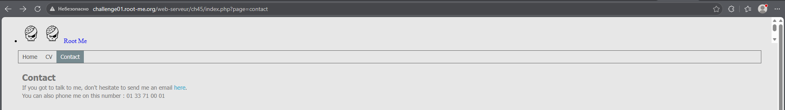
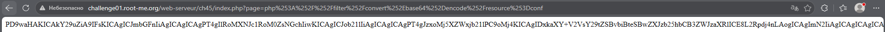
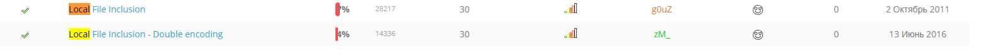

# Root-Me Challenge: Local File Inclusion - Double encoding

## Challenge Description
- **Platform:** Root-Me
- **Category:** Web - Server
- **Difficulty:** 30 points
- **Objective:** Retrieve the password (flag) to validate the challenge.

## Vulnerability Analysis
The application uses the `page` parameter to include files. The developer implemented a filter that blocks common traversal sequences (`../`) and their standard URL-encoded forms (`%2e%2e%2f`).

However, the filter fails to account for **double URL-encoding**. By encoding the `%` character itself (e.g., `%252f`), the filter sees a harmless string, but the PHP backend decodes it twice, resulting in a valid traversal sequence (`%2f` -> `/`).

## Exploitation Steps
1. Navigated to the challenge URL and confirmed the vulnerable parameter: `?page=contact`.
2. Attempted standard traversal (`?page=..%2f..%2f..%2f..%2fetc%2fpasswd`), which triggered the filter and returned `"Attack detected."`.
3. Attempted double encoding (`?page=..%252f..%252f..%252f..%252fetc%252fpasswd`), which also triggered the filter.
4. Bypassed the filter by using a PHP wrapper (`php://filter`) with double encoding to read the source code of `conf.inc.php`:
   ```text
   ?page=php%253A%252F%252Ffilter%252Fconvert%252Ebase64%252Dencode%252Fresource%253Dconf
   ```
5. The application returned a Base64-encoded string. Decoding it revealed the source code and the flag:
   ```php
   "flag" => "Th1sIsTh3Fl4g!"
   ```
6. Submitted the flag on the Root-Me validation page and successfully solved the challenge.

## Evidence

### Initial Page


### Bypass and Base64 Output


### Challenge Solved (Both LFI challenges completed)


## Mitigation
To prevent LFI and filter bypasses:
1. **Allowlist:** Only allow specific, predefined page names (e.g., `home`, `contact`).
2. **Strict Validation:** Do not rely on string replacement. Use `realpath()` to resolve the final path and verify it is within the allowed directory.
3. **Disable PHP Wrappers:** Disable `allow_url_include` and restrict `php://` wrappers if they are not explicitly needed.